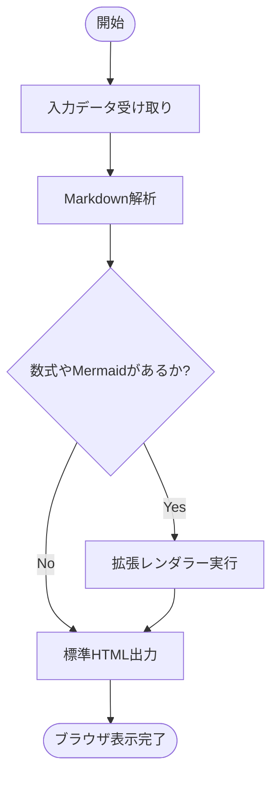
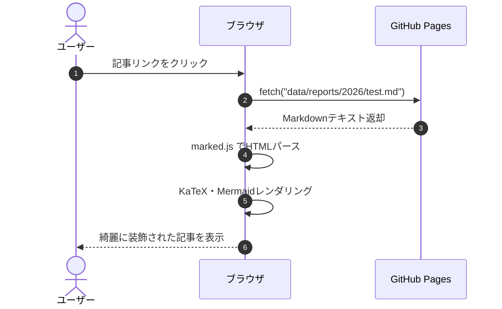

# Markdown記法・対応機能 実例チートシート

このドキュメントは、情報技術サークルWebサイトのレポート（記事）作成で利用できる **「Markdown記法および各種拡張機能」の書き方コードと実際のレンダリング結果** をまとめた実例チートシートです。

記事を執筆する際は、ここにあるコードをコピー＆ペーストしてご利用いただけます。

## 目次

```markdown
[TOC]
```

**【表示プレビュー】**

[TOC]

---

## 1. テキスト装飾・インライン記法

文章内の特定の文字を強調したり、数式やマーカーを引いたりするためのインライン記法です。

### 1-1. 見出し（Headers）
文章の階層構造を示します。見出し2〜4は目次（[TOC]）に自動収集されます。

```markdown
# 見出し 1（記事タイトル相当）
## 見出し 2（大見出し）
### 見出し 3（中見出し）
#### 見出し 4（小見出し）
```

**【表示プレビュー】**
> ※ 見出し1は記事最上部のタイトルとして適用されています。
#### 見出し 4 の表示サンプル

---

### 1-2. 太字・斜体・取り消し線
重要な語句を強調したり、打ち消し線を入れたりします。

```markdown
- **太字（Bold）** です。
- *斜体（Italic）* です。
- ***太字かつ斜体*** です。
- ~~取り消し線（Strikethrough）~~ です。
```

**【表示プレビュー】**
- **太字（Bold）** です。
- *斜体（Italic）* です。
- ***太字かつ斜体*** です。
- ~~取り消し線（Strikethrough）~~ です。

---

### 1-3. 蛍光ペン風マーカー記法（独自拡張）
強調したい単語やフレーズにマーカーを引くことができます。

```markdown
ここは重要なポイントなので、==このようにマーカーを引いて== 強調します。
```

**【表示プレビュー】**
ここは重要なポイントなので、==このようにマーカーを引いて== 強調します。

---

### 1-4. インラインコード・キーボードキー
コードの変数名やキーボードのショートカットキーを記述する記法です。

```markdown
- 変数 `count` や関数 `initReport()` のようにバッククォートで囲みます。
- ショートカットキーの案内には `<kbd>Ctrl</kbd> + <kbd>C</kbd>` が使えます。
```

**【表示プレビュー】**
- 変数 `count` や関数 `initReport()` のようにバッククォートで囲みます。
- ショートカットキーの案内には <kbd>Ctrl</kbd> + <kbd>C</kbd> が使えます。

---

### 1-5. インライン数式（KaTeX）
文章の中にインラインで数式を埋め込みます。`$ ... $` または `\( ... \)` を使用します。

```markdown
アインシュタインの質量とエネルギーの等価性は $E = mc^2$ で表されます。
また、ピタゴラスの定理は \( a^2 + b^2 = c^2 \) です。
```

**【表示プレビュー】**
アインシュタインの質量とエネルギーの等価性は $E = mc^2$ で表されます。
また、ピタゴラスの定理は \( a^2 + b^2 = c^2 \) です。

---

## 2. リスト・表組み・引用

### 2-1. 箇条書き・番号付きリスト
階層を持ったリストを作成できます。半角スペース2〜4個でインデントします。

```markdown
- 箇条書きアイテム A
  - サブアイテム A-1
  - サブアイテム A-2
- 箇条書きアイテム B

1. 手順その1：環境を整える
2. 手順その2：Markdownで原稿を書く
3. 手順その3：プレビューで確認する
```

**【表示プレビュー】**
- 箇条書きアイテム A
  - サブアイテム A-1
  - サブアイテム A-2
- 箇条書きアイテム B

1. 手順その1：環境を整える
2. 手順その2：Markdownで原稿を書く
3. 手順その3：プレビューで確認する

---

### 2-2. タスクリスト（GFM対応）
チェックボックス付きのやることリストです。サークルのブランドカラー（青色）にスタイリングされています。

```markdown
- [x] サークル紹介サイトの設計完了
- [x] レポート機能（Markdownプレビュー）の実装
- [ ] 今月の活動報告記事の執筆
- [ ] 次期コンテスト参加者の募集
```

**【表示プレビュー】**
- [x] サークル紹介サイトの設計完了
- [x] レポート機能（Markdownプレビュー）の実装
- [ ] 今月の活動報告記事の執筆
- [ ] 次期コンテスト参加者の募集

---

### 2-3. テーブル（表組み・GFM対応）
パイプ記号 `|` で表を作成します。コロン `:` の位置で「左寄せ」「中央揃え」「右寄せ」を指定できます。

```markdown
| 言語 / 項目 | 分類 | 難易度 | 用途 |
| :--- | :---: | ---: | :--- |
| **Python** | スクリプト | ★☆☆ | データ分析・AI・競プロ |
| **C++** | コンパイル | ★★★ | 競技プログラミング・高速処理 |
| **JavaScript** | Webフロント | ★★☆ | Webサイト・Webアプリ開発 |
```

**【表示プレビュー】**

| 言語 / 項目 | 分類 | 難易度 | 用途 |
| :--- | :---: | ---: | :--- |
| **Python** | スクリプト | ★☆☆ | データ分析・AI・競プロ |
| **C++** | コンパイル | ★★★ | 競技プログラミング・高速処理 |
| **JavaScript** | Webフロント | ★★☆ | Webサイト・Webアプリ開発 |

---

### 2-4. 引用（Blockquote）
他からの引用や注釈を記述します。

```markdown
> これは通常の引用ブロックです。
> 複数行にわたって引用を続けることも可能です。
```

**【表示プレビュー】**
> これは通常の引用ブロックです。
> 複数行にわたって引用を続けることも可能です。

---

## 3. GitHub風アラート・コールアウト記法

引用ブロックの先頭に `[!TYPE]` を書くことで、用途に応じた5種類のアラートボックスを作成できます。

### 3-1. Note（補足・情報）
```markdown
> [!NOTE]
> ここには補足情報や背景の説明、関連する前提知識などを記載します。
```
**【表示プレビュー】**
> [!NOTE]
> ここには補足情報や背景の説明、関連する前提知識などを記載します。

---

### 3-2. Tip（ヒント・アドバイス）
```markdown
> [!TIP]
> 効率的な実装方法やおすすめのショートカット、推奨設定などを記載します。
```
**【表示プレビュー】**
> [!TIP]
> 効率的な実装方法やおすすめのショートカット、推奨設定などを記載します。

---

### 3-3. Important（重要事項）
```markdown
> [!IMPORTANT]
> 見逃してほしくない必須要件や重要な手順を記載します。
```
**【表示プレビュー】**
> [!IMPORTANT]
> 見逃してほしくない必須要件や重要な手順を記載します。

---

### 3-4. Warning（警告・注意）
```markdown
> [!WARNING]
> 仕様変更による影響や互換性の問題、注意すべき副作用を記載します。
```
**【表示プレビュー】**
> [!WARNING]
> 仕様変更による影響や互換性の問題、注意すべき副作用を記載します。

---

### 3-5. Caution（危険・厳重警告）
```markdown
> [!CAUTION]
> データの損失、不可逆な変更、セキュリティリスクなどを記載します。
```
**【表示プレビュー】**
> [!CAUTION]
> データの損失、不可逆な変更、セキュリティリスクなどを記載します。

---

## 4. KaTeX 数式（ブロック数式）

`$$ ... $$` または `\[ ... \]` で囲むと、中央揃えの綺麗な数式ブロックとして描画されます。
長い数式でも、スマートフォン表示時に画面外へはみ出さず、横スクロールできます。

```markdown
$$
\int_{-\infty}^{\infty} e^{-x^2} \, dx = \sqrt{\pi}
$$

$$
A = \begin{pmatrix}
a_{11} & a_{12} & \dots & a_{1n} \\
a_{21} & a_{22} & \dots & a_{2n} \\
\vdots & \vdots & \ddots & \vdots \\
a_{m1} & a_{m2} & \dots & a_{mn}
\end{pmatrix}
$$
```

**【表示プレビュー】**

$$
\int_{-\infty}^{\infty} e^{-x^2} \, dx = \sqrt{\pi}
$$

$$
A = \begin{pmatrix}
a_{11} & a_{12} & \dots & a_{1n} \\
a_{21} & a_{22} & \dots & a_{2n} \\
\vdots & \vdots & \ddots & \vdots \\
a_{m1} & a_{m2} & \dots & a_{mn}
\end{pmatrix}
$$

---

## 5. Mermaid ダイアグラム（GitHub標準操作ツールバー対応）

コードブロックに ```` ```mermaid ```` を指定すると、フローチャートやシーケンス図などを描画できます。
図の右上に **操作ツールバー（移動・拡大・縮小・リセット）** が表示され、マウスドラッグやボタンクリックで図を自由に操作できます。

### 5-1. フローチャート（Flowchart）
````markdown

````

**【表示プレビュー】**


---

### 5-2. シーケンス図（Sequence Diagram）
````markdown

````

**【表示プレビュー】**


---

## 6. コードブロック（シンタックスハイライト）

言語名を指定することで、自動的にコードのキーワードが色分けされます。

### Python 例
````markdown
```python
def fibonacci(n: int) -> int:
    """フィボナッチ数を再帰的に計算する"""
    if n <= 0:
        return 0
    elif n == 1:
        return 1
    return fibonacci(n - 1) + fibonacci(n - 2)

print([fibonacci(i) for i in range(10)])
```
````

**【表示プレビュー】**
```python
def fibonacci(n: int) -> int:
    """フィボナッチ数を再帰的に計算する"""
    if n <= 0:
        return 0
    elif n == 1:
        return 1
    return fibonacci(n - 1) + fibonacci(n - 2)

print([fibonacci(i) for i in range(10)])
```

### JavaScript 例
````markdown
```javascript
// レポートのデータを取得して描画するサンプル
async function loadReport(fileName) {
    try {
        const res = await fetch(`data/reports/${fileName}`);
        if (!res.ok) throw new Error("404 Not Found");
        const markdown = await res.text();
        console.log("読み込み成功:", markdown.length, "文字");
    } catch (err) {
        console.error("エラー:", err);
    }
}
```
````

**【表示プレビュー】**
```javascript
// レポートのデータを取得して描画するサンプル
async function loadReport(fileName) {
    try {
        const res = await fetch(`data/reports/${fileName}`);
        if (!res.ok) throw new Error("404 Not Found");
        const markdown = await res.text();
        console.log("読み込み成功:", markdown.length, "文字");
    } catch (err) {
        console.error("エラー:", err);
    }
}
```

---

## 7. メディア・リンクの埋め込み

### 7-1. リンク
```markdown
- [情報技術サークル ホームへ戻る](index.html)
- 📄 [SuperCon2026 チームレポート PDFを開く](images/pdf/SuperCon2026_チーム15レポート.pdf)
- [ページのトップへ戻る](h1)
- 外部サイト: [Google](https://www.google.com)
- URL自動リンク: https://github.com
```

**【表示プレビュー】**
- [情報技術サークル ホームへ戻る](index.html)
- 📄 [SuperCon2026 チームレポート PDFを開く](images/pdf/SuperCon2026_チーム15レポート.pdf)
- [ページのトップへ戻る](# Markdown記法・対応機能 実例チートシート)
- 外部サイト: [Google](https://www.google.com)
- URL自動リンク: https://github.com

---

### 7-2. 画像
```markdown

```

**【表示プレビュー】**

