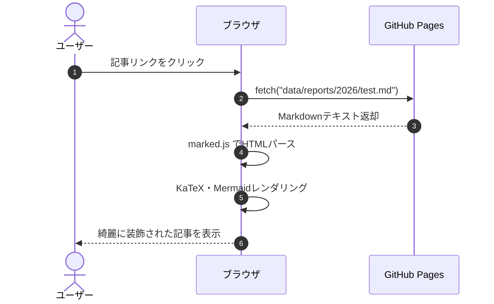

# Markdown記法・対応機能 実例チートシート

このドキュメントは、情報技術サークルWebサイトのレポート（記事）作成で利用できる **「Markdown記法および各種拡張機能」の書き方コードと実際のレンダリング結果** をまとめた実例チートシートです。

記事を執筆する際は、ここにあるコードをコピー＆ペーストしてご利用いただけます。

<h2 class="no-toc">目次</h2>

```markdown
[TOC]
```

**【表示プレビュー】**

[TOC]

---

## 1. テキスト装飾・インライン記法

文章内の特定の文字を強調したり、数式やマーカーを引いたりするためのインライン記法です。

### 1-1. 見出し（Headers）
文章の階層構造を示します。見出し2〜4は目次（[TOC]）に自動収集されます。

```markdown
# 見出し 1（記事タイトル相当）
## 見出し 2（大見出し）
### 見出し 3（中見出し）
#### 見出し 4（小見出し）
```

**【表示プレビュー】**
<h1 class="no-toc">見出し 1（記事タイトル相当）</h1>
<h2 class="no-toc">見出し 2（大見出し）</h2>
<h3 class="no-toc">見出し 3（中見出し）</h3>
<h4 class="no-toc">見出し 4（小見出し）</h4>

---

### 1-2. 太字・斜体・取り消し線・インライン
重要な語句を強調したり、打ち消し線を入れたりします。
インラインはコードの変数名を記述する記法です。
> [!NOTE]
> 視認性向上やエラー防止のため、前後に半角改行の入力を推奨します。
```markdown
- **太字（Bold）** です。
- *斜体（Italic）* です。
- ***太字かつ斜体*** です。
- ~~取り消し線（Strikethrough）~~ です。
- 変数 `count` や関数 `initReport()` のようにバッククォートで囲みます。
```

**【表示プレビュー】**
- **太字（Bold）** です。
- *斜体（Italic）* です。
- ***太字かつ斜体*** です。
- ~~取り消し線（Strikethrough）~~ です。
- 変数 `count` や関数 `initReport()` のようにバッククォートで囲みます。

---

### 1-3. 蛍光ペン風マーカー記法（独自拡張）
強調したい単語やフレーズにマーカーを引くことができます。

```markdown
ここは重要なポイントなので、==このようにマーカーを引いて== 強調します。
```

**【表示プレビュー】**
ここは重要なポイントなので、==このようにマーカーを引いて== 強調します。

---

### 1-4. インライン数式（KaTeX）
文章の中にインラインで数式を埋め込みます。`$ ... $` または `\( ... \)` を使用します。

```markdown
アインシュタインの質量とエネルギーの等価性は $E = mc^2$ で表されます。
また、ピタゴラスの定理は \( a^2 + b^2 = c^2 \) です。
```

**【表示プレビュー】**
アインシュタインの質量とエネルギーの等価性は $E = mc^2$ で表されます。
また、ピタゴラスの定理は \( a^2 + b^2 = c^2 \) です。

---

## 2. リスト・表組み・引用・区切り線

### 2-1. 箇条書き・番号付きリスト・タスクリスト
階層を持った箇条書きや番号付き手順、およびチェックボックス付きタスクリストを作成できます。
> [!TIP]
> 入れ子構造にするときは、<kbd>Tab</kbd> でインデントしよう！

```markdown
- 箇条書きアイテム A
  - サブアイテム A-1
    - サブサブアイテム A-1-1
- 箇条書きアイテム B

1. 手順その1：環境を整える
2. 手順その2：Markdownで原稿を書く
3. 手順その3：プレビューで確認する

- [x] レポート機能（Markdownプレビュー）の実装
- [ ] サイト内コンテンツの拡充
```

**【表示プレビュー】**
- 箇条書きアイテム A
  - サブアイテム A-1
    - サブサブアイテム A-1-1
- 箇条書きアイテム B

1. 手順その1：環境を整える
2. 手順その2：Markdownで原稿を書く
3. 手順その3：プレビューで確認する

- [x] レポート機能（Markdownプレビュー）の実装
- [ ] サイト内コンテンツの拡充

---

### 2-2. テーブル（表組み）
パイプ記号 `|` で表を作成します。コロン `:` の位置で「左寄せ」「中央揃え」「右寄せ」を指定できます。

```markdown
| 言語 / 項目 | 分類 | 難易度 | 用途 |
| :--- | :---: | :---: | ---: |
| **Python** | スクリプト | ★☆☆ | データ分析・AI・競プロ |
| **C++** | コンパイル | ★★★ | 競技プログラミング・高速処理 |
| **JavaScript** | Webフロント | ★★☆ | Webサイト・Webアプリ開発 |
```

**【表示プレビュー】**

| 言語 / 項目 | 分類 | 難易度 | 用途 |
| :--- | :---: | :---: | ---: |
| **Python** | スクリプト | ★☆☆ | データ分析・AI・競プロ |
| **C++** | コンパイル | ★★★ | 競技プログラミング・高速処理 |
| **JavaScript** | Webフロント | ★★☆ | Webサイト・Webアプリ開発 |

---

### 2-3. 引用（Blockquote）
他からの引用や注釈を記述します。行頭に `>` を付けます。

```markdown
> これは通常の引用ブロックです。
> 複数行にわたって引用を続けることも可能です。
```

**【表示プレビュー】**
> これは通常の引用ブロックです。
> 複数行にわたって引用を続けることも可能です。

---

### 2-4. 水平区切り線（Thematic Breaks）
段落や話題の切り替えを示す水平線（`<hr>`）を挿入します。

ハイフン（`-`）、アスタリスク（`*`）、またはアンダースコア（`_`）を**単独の行に3個以上**並べることで記述できます。記号の間に半角スペースを挟むことも可能です。

> [!NOTE]
> 前後の段落との間に空行がない場合、ハイフン（`---`）直上のテキストが見出し（h2）として認識されてしまうことがあります。区切り線の **前後は1行空ける** のがベストプラクティスです。

```markdown
---
***
___
- - -
```

**【表示プレビュー】**

---
***
___
- - -

## 3. メディア・リンクの埋め込み

### 3-1. リンク
```markdown
- [情報技術サークル ホームへ戻る](index.html)
- 📄 [SuperCon2026 チームレポート PDFを開く](images/pdf/SuperCon2026_チーム15レポート.pdf)
- 外部サイト: [Google](https://www.google.com)
- URL自動リンク: https://github.com
```

**【表示プレビュー】**
- [情報技術サークル ホームへ戻る](index.html)
- 📄 [SuperCon2026 チームレポート PDFを開く](images/pdf/SuperCon2026_チーム15レポート.pdf)
- 外部サイト: [Google](https://www.google.com)
- URL自動リンク: https://github.com

---

### 3-2. 画像
画像の幅や高さは直接指定できず、枠に収まる最大のサイズで表示されます。

```markdown

```
<details class="md-details">
<summary>【表示プレビュー】</summary>


</details>

---

## 4. コードブロック

言語名を指定することで、自動的にコードのキーワードが色分けされます。右上のコピーボタンからコード全体をワンクリックでコピーできます。

````markdown
```python
def fibonacci(n: int) -> int:
    """フィボナッチ数を再帰的に計算する"""
    if n <= 0:
        return 0
    elif n == 1:
        return 1
    return fibonacci(n - 1) + fibonacci(n - 2)

print([fibonacci(i) for i in range(10)])
```
````

**【表示プレビュー】**

```python
def fibonacci(n: int) -> int:
    """フィボナッチ数を再帰的に計算する"""
    if n <= 0:
        return 0
    elif n == 1:
        return 1
    return fibonacci(n - 1) + fibonacci(n - 2)

print([fibonacci(i) for i in range(10)])
```


<details class="md-details">
<summary>JavaScriptの例</summary>

````markdown
```javascript
// レポートのデータを取得して描画するサンプル
async function loadReport(fileName) {
    try {
        const res = await fetch(`data/reports/${fileName}`);
        if (!res.ok) throw new Error("404 Not Found");
        const markdown = await res.text();
        console.log("読み込み成功:", markdown.length, "文字");
    } catch (err) {
        console.error("エラー:", err);
    }
}
```
````
**【表示プレビュー】**
```javascript
// レポートのデータを取得して描画するサンプル
async function loadReport(fileName) {
    try {
        const res = await fetch(`data/reports/${fileName}`);
        if (!res.ok) throw new Error("404 Not Found");
        const markdown = await res.text();
        console.log("読み込み成功:", markdown.length, "文字");
    } catch (err) {
        console.error("エラー:", err);
    }
}
```

</details>

---

## 5. GitHub風アラート・コールアウト記法

引用ブロックの先頭に `[!TYPE]` を書くことで、用途に応じた5種類のアラートボックスを作成できます。

```markdown
> [!NOTE]
> ここには補足情報や背景の説明、関連する前提知識などを記載します。

> [!TIP]
> 効率的な実装方法やおすすめのショートカット、推奨設定などを記載します。

> [!IMPORTANT]
> 見逃してほしくない必須要件や重要な手順を記載します。

> [!WARNING]
> 仕様変更による影響や互換性の問題、注意すべき副作用を記載します。

> [!CAUTION]
> データの損失、不可逆な変更、セキュリティリスクなどを記載します。
```

**【表示プレビュー】**

> [!NOTE]
> ここには補足情報や背景の説明、関連する前提知識などを記載します。

> [!TIP]
> 効率的な実装方法やおすすめのショートカット、推奨設定などを記載します。

> [!IMPORTANT]
> 見逃してほしくない必須要件や重要な手順を記載します。

> [!WARNING]
> 仕様変更による影響や互換性の問題、注意すべき副作用を記載します。

> [!CAUTION]
> データの損失、不可逆な変更、セキュリティリスクなどを記載します。

---

## 6. KaTeX 数式（ブロック数式）

`$$ ... $$` または `\[ ... \]` で囲むと、中央揃えの綺麗な数式ブロックとして描画されます。
長い数式でも、スマートフォン表示時に画面外へはみ出さず、横スクロールできます。

```markdown
$$
\int_{-\infty}^{\infty} e^{-x^2} \, dx = \sqrt{\pi}
$$

$$
A = \begin{pmatrix}
a_{11} & a_{12} & \dots & a_{1n} \\
a_{21} & a_{22} & \dots & a_{2n} \\
\vdots & \vdots & \ddots & \vdots \\
a_{m1} & a_{m2} & \dots & a_{mn}
\end{pmatrix}
$$
```

**【表示プレビュー】**

$$
\int_{-\infty}^{\infty} e^{-x^2} \, dx = \sqrt{\pi}
$$

$$
A = \begin{pmatrix}
a_{11} & a_{12} & \dots & a_{1n} \\
a_{21} & a_{22} & \dots & a_{2n} \\
\vdots & \vdots & \ddots & \vdots \\
a_{m1} & a_{m2} & \dots & a_{mn}
\end{pmatrix}
$$

---

## 7. Mermaid ダイアグラム

コードブロックに ```` ```mermaid ```` を指定すると、フローチャートやシーケンス図などを描画できます。
図の右上に **操作ツールバー（移動・拡大・縮小・リセット）** が表示され、マウスドラッグやボタンクリックで図を自由に操作できます。

<details class="md-details">
<summary>フローチャート</summary>

````markdown

````
**【表示プレビュー】**


</details>

<details class="md-details">
<summary>シーケンス図</summary>

````markdown

````
**【表示プレビュー】**


</details>

---

## 8. よく使うHTML構文

Markdownだけでは表現しにくい高度なレイアウト、動画・SNS・PDFの埋め込み、文字装飾、カード表示などのHTML構文の実例と書き方です。
直接HTMLタグを記述することで、そのまま安全に反映されます。

### 8-1. 画像の特殊埋め込み（サイズ指定・リンク・キャプション）
画像の表示幅（ピクセルやパーセント）を指定したり、クリックでリンク先に飛ぶ画像、キャプション付き画像を配置できます。

```html
<!-- 幅300px・中央寄せ -->
<p align="center">
  
</p>

<!-- リンク付き画像 -->
<a href="index.html">
  
</a>

<!-- キャプション（説明文）付き画像 -->
<figure>
  
  <figcaption>図1：情報技術サークルの公式ロゴマーク</figcaption>
</figure>
```

**【表示プレビュー】**

<p align="center">
  
</p>

<a href="index.html">
  
</a>

<figure>
  
  <figcaption>図1：情報技術サークルの公式ロゴマーク</figcaption>
</figure>

---

### 8-2. 文字の装飾（インラインCSSによる色・サイズ変更）
`<span style="...">` を使用して、特定の部分だけ文字色や大きさを自由に変更できます。

```html
- <span style="color: #2f80ed; font-weight: bold;">青色の太字テキスト</span>
- <span style="color: #ef4444; font-size: 1.2em;">赤色で少し大きいテキスト</span>
- <span style="background-color: #fef08a; padding: 2px 6px; border-radius: 4px;">背景色つきハイライト</span>
- <span style="text-decoration: underline wavy #3b82f6;">波線の下線テキスト</span>
```

**【表示プレビュー】**
- <span style="color: #2f80ed; font-weight: bold;">青色の太字テキスト</span>
- <span style="color: #ef4444; font-size: 1.2em;">赤色で少し大きいテキスト</span>
- <span style="background-color: #fef08a; padding: 2px 6px; border-radius: 4px;">背景色つきハイライト</span>
- <span style="text-decoration: underline wavy #3b82f6;">波線の下線テキスト</span>

---

### 8-3. アコーディオン・折りたたみ表示（`<details>` & `<summary>`）
長いソースコードや大会の解答解説、補足情報をすっきりと隠し、読者がクリックしたときだけ展開できます。JavaScript不要の標準機能です。

> [!IMPORTANT]
> **HTML構文内で、Markdown記法等を使う場合の注意点**
> 1. **空行を空ける**: HTMLとMarkdownの境界は、必ず**空行を1行**空けてください。（空行がないと全体がHTML扱いとなり、内部のMarkdown記法が無効になります）
> 2. **行頭（インデントなし）から書く**: 内側のMarkdownは**スペースを空けずに行頭から**書いてください。行頭に4つ以上のスペースやタブを入れると、Markdownの仕様により意図せずコードブロックとして認識されてしまいます。

```markdown
<details class="md-details">
<summary>ここをクリックしてを展開</summary>

##### これまで紹介した記法の例
- [x] 円の公式は、 \((x-\alpha)^2+(y-\beta)^2=r^2\) で、 \((\alpha,\beta)\) は、円の **中心座標** を表します。
- ラジアン *(弧度法)* とは、 ~~半径1の円~~ <span style="color: #ef4444; font-weight: bold;">単位円</span> の ==「弧の長さ」で表した角度の単位== です。
> [!NOTE]
> 折りたたみ内の見出しは、目次（`TOC`）には追加されません。

</details>
```

**【表示プレビュー】**

<details class="md-details">
<summary>ここをクリックして展開</summary>

##### これまで紹介した記法の例
- [x] 円の公式は、 \((x-\alpha)^2+(y-\beta)^2=r^2\) で、 \((\alpha,\beta)\) は、円の **中心座標** を表します。
- ラジアン *(弧度法)* とは、 ~~半径1の円~~ <span style="color: #ef4444; font-weight: bold;">単位円</span> の ==「弧の長さ」で表した角度の単位== です。
> [!NOTE]
> 折りたたみ内の見出しは、目次（`TOC`）には追加されません。

</details>

---

### 8-4. 2カラム・複数列レイアウト（Flexbox & Grid）
「左に画像、右に解説文」を並べたり、複数要素をカード状に横並びさせることができます。スマホ画面では自動的に1列にスタックされます。

```html
<!-- 左右2カラム分割レイアウト -->
<div class="columns-2">
  <div>
    
  </div>
  <div>
    <h4 class="no-toc">左画像・右解説のレイアウト</h4>
    <p>スマートフォンの画面幅では自動的に縦並びに切り替わります。活動写真とインタビューや、作品画像と説明文を左右に並べたいときに便利です。</p>

> [!NOTE]
> 見出しを目次（`TOC`）に追加させたくない場合は、 `class="no-toc"` を指定します。

  </div>
</div>
```

**【表示プレビュー】**

<div class="columns-2">
  <div>
    
  </div>
  <div>
    <h2 class="no-toc">左画像・右解説のレイアウト</h2>
    <p>スマートフォンの画面幅では自動的に縦並びに切り替わります。活動写真とインタビューや、作品画像と説明文を左右に並べたいときに便利です。</p>

> [!NOTE]
> 見出しを目次（`TOC`）に追加させたくない場合は、 `class="no-toc"` を指定します。

  </div>
</div>

---

### 8-5. SNSの埋め込み
YouTube・X（Twitter）・Instagramの埋め込みに対応しています。
各サービスが発行する**埋め込みコード**を取得して貼り付けることで、リッチな埋め込みカードや動画プレーヤーが表示されます。

<details class="md-details">
<summary>YouTube</summary>

`.video-container` で `<iframe>` を囲むことで、PCでもスマートフォンでもアスペクト比 16:9 を綺麗に保ちながら画面幅いっぱいにフィットします。

```html
<div class="video-container">
  <iframe width="1037" 
    height="583" 
    src="https://www.youtube.com/embed/jVpP5bIff8A" 
    title="令和3年度多摩高校学校紹介動画 10分ver" 
    frameborder="0" 
    allow="accelerometer; autoplay; clipboard-write; encrypted-media; gyroscope; picture-in-picture; web-share" 
    referrerpolicy="strict-origin-when-cross-origin" allowfullscreen>
  </iframe>
</div>
```

**【表示プレビュー】**

<div class="video-container">
  <iframe width="1037" 
    height="583" 
    src="https://www.youtube.com/embed/jVpP5bIff8A" 
    title="令和3年度多摩高校学校紹介動画 10分ver" 
    frameborder="0" 
    allow="accelerometer; autoplay; clipboard-write; encrypted-media; gyroscope; picture-in-picture; web-share" 
    referrerpolicy="strict-origin-when-cross-origin" allowfullscreen>
  </iframe>
</div>

</details>

<details class="md-details">
<summary>X（Twitter）</summary>

公式の埋め込みコード（`<blockquote class="twitter-tweet">`）を貼り付けると、`report.js` が公式スクリプトを自動呼び出しし、リッチなポストカードに変換します。

```html
<div class="sns-container">
  <blockquote class="twitter-tweet">
    <p lang="ja" dir="ltr">今年から活動を開始した、神奈川県立多摩高等学校 情報技術サークルです！　このアカウントでは、定期的に活動報告をしていく予定です。よろしくお願いします！_(._.)_</p>
    &mdash; 神奈川県立多摩高等学校 情報技術サークル (@TAMA_ITcircle)
    <a href="https://x.com/TAMA_ITcircle/status/2049768859490816371?ref_src=twsrc%5Etfw">April 30, 2026</a>
  </blockquote>
  <script async src="https://platform.x.com/widgets.js" charset="utf-8"></script>
</div>
```

**【表示プレビュー】**

<div class="sns-container">
  <blockquote class="twitter-tweet">
    <p lang="ja" dir="ltr">今年から活動を開始した、神奈川県立多摩高等学校 情報技術サークルです！　このアカウントでは、定期的に活動報告をしていく予定です。よろしくお願いします！_(._.)_</p>
    &mdash; 神奈川県立多摩高等学校 情報技術サークル (@TAMA_ITcircle)
    <a href="https://x.com/TAMA_ITcircle/status/2049768859490816371?ref_src=twsrc%5Etfw">April 30, 2026</a>
  </blockquote>
  <script async src="https://platform.x.com/widgets.js" charset="utf-8"></script>
</div>

</details>

<details class="md-details">
<summary>Instagram</summary>

投稿の「埋め込み」から取得した公式埋め込みコード（`<blockquote class="instagram-media">`）を貼り付けると、`report.js` が自動的にInstagram埋め込みスクリプトをロードして中央揃えのカードとして表示します。

```html
<div class="sns-container">
  <blockquote class="instagram-media" data-instgrm-captioned data-instgrm-permalink="https://www.instagram.com/p/DcaDHYOTC29/?utm_source=ig_embed&amp;utm_campaign=loading" data-instgrm-version="14">
    <a href="https://www.instagram.com/p/DcaDHYOTC29/?utm_source=ig_embed&amp;utm_campaign=loading" target="_blank">この投稿をInstagramで見る</a>
  </blockquote>
  <script async src="//www.instagram.com/embed.js"></script>
</div>
```

**【表示プレビュー】**

<div class="sns-container">
  <blockquote class="instagram-media" data-instgrm-captioned data-instgrm-permalink="https://www.instagram.com/p/DcaDHYOTC29/?utm_source=ig_embed&amp;utm_campaign=loading" data-instgrm-version="14" style=" background:#FFF; border:0; border-radius:3px; box-shadow:0 0 1px 0 rgba(0,0,0,0.5),0 1px 10px 0 rgba(0,0,0,0.15); margin: 1px; max-width:540px; min-width:326px; padding:0; width:99.375%; width:-webkit-calc(100% - 2px); width:calc(100% - 2px);"><div style="padding:16px;"> <a href="https://www.instagram.com/p/DcaDHYOTC29/?utm_source=ig_embed&amp;utm_campaign=loading" style=" background:#FFFFFF; line-height:0; padding:0 0; text-align:center; text-decoration:none; width:100%;" target="_blank"> <div style=" display: flex; flex-direction: row; align-items: center;"> <div style="background-color: #F4F4F4; border-radius: 50%; flex-grow: 0; height: 40px; margin-right: 14px; width: 40px;"></div>

</details>

---


### 8-6. 記事・作品紹介カード（.article-card）
記事内で他のレポートや制作物をリッチに紹介するためのカードコンポーネントです。

```html
<a class="article-card" href="works.html">
  
  <div class="article-card-body">
    <span class="article-card-tag">作品紹介</span>
    <h4 class="article-card-title">サークル作品一覧ページ</h4>
    <p class="article-card-text">サークルメンバーが制作したWebアプリ、ゲーム、ツールなどの成果物を一覧でご覧いただけます。</p>
  </div>
</a>
```

**【表示プレビュー】**

<a class="article-card" href="works.html">
  
  <div class="article-card-body">
    <span class="article-card-tag">作品紹介</span>
    <h4 class="article-card-title">サークル作品一覧ページ</h4>
    <p class="article-card-text">サークルメンバーが制作したWebアプリ、ゲーム、ツールなどの成果物を一覧でご覧いただけます。</p>
  </div>
</a>

---

### 8-7. PDFプレビュー埋め込み（.pdf-container）
Google Drive経由のプレビューや、サイト内PDFを記事内で直接閲覧できる埋め込み枠です。

```html
<!-- PDFプレビュー枠 -->
<div class="pdf-container">
  <iframe
    src="images/pdf/SuperCon2026_チーム15レポート.pdf"
    title="PDF資料プレビュー">
  </iframe>
</div>
<p style="text-align: right; font-size: 0.85rem;">
  📄 <a href="images/pdf/SuperCon2026_チーム15レポート.pdf" target="_blank" rel="noopener">別タブでPDFを開く</a>
</p>
```

**【表示プレビュー】**

<div class="pdf-container">
  <iframe
    src="images/pdf/SuperCon2026_チーム15レポート.pdf"
    title="PDF資料プレビュー">
  </iframe>
</div>
<p style="text-align: right; font-size: 0.85rem;">
  📄 <a href="images/pdf/SuperCon2026_チーム15レポート.pdf" target="_blank" rel="noopener">別タブでPDFを開く</a>
</p>

---

### 8-9. キーボードショートカット装飾（`<kbd>`）
操作説明やチュートリアルで、押すべきキーを直感的に案内できます。

```html
<kbd>Ctrl</kbd> + <kbd>Shift</kbd> + <kbd>P</kbd> でコマンドパレットを開きます。
```

**【表示プレビュー】**
<kbd>Ctrl</kbd> + <kbd>Shift</kbd> + <kbd>P</kbd> でコマンドパレットを開きます。

---

### 8-9. 音声・動画タグ（`<audio>` / `<video>`）
サイト内に配置した音声ファイル（.mp3）や動画ファイル（.mp4）を直接ブラウザ上で再生できます。

```html
<!-- 音声プレイヤー -->
<audio controls style="width: 100%; margin: 1em 0;">
  <source src="images/sample.mp3" type="audio/mp3">
  お使いのブラウザは音声再生に対応していません。
</audio>
```

**【表示プレビュー】**
<audio controls style="width: 100%; margin: 1em 0;">
  <source src="images/sample.mp3" type="audio/mp3">
  お使いのブラウザは音声再生に対応していません。
</audio>
