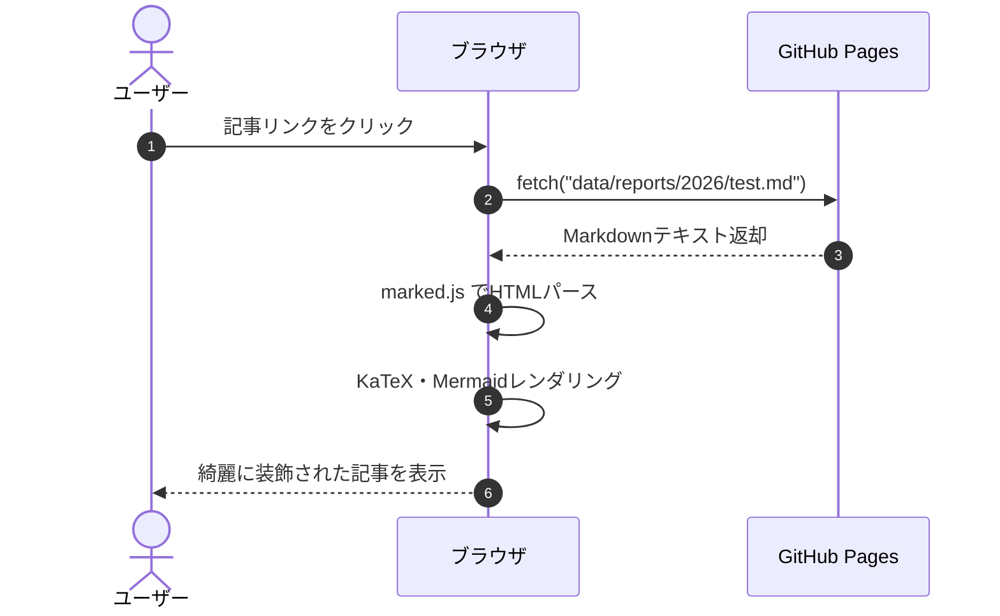

# Markdown記法・対応機能 実例チートシート

このドキュメントは、情報技術サークルWebサイトのレポート（記事）作成で利用できる **「Markdown記法および各種拡張機能」の書き方コードと実際のレンダリング結果** をまとめた実例チートシートです。

記事を執筆する際は、ここにあるコードをコピー＆ペーストしてご利用いただけます。

## 目次

```markdown
[TOC]
```

**【表示プレビュー】**

[TOC]

---

## 1. テキスト装飾・インライン記法

文章内の特定の文字を強調したり、数式やマーカーを引いたりするためのインライン記法です。

### 1-1. 見出し（Headers）
文章の階層構造を示します。見出し2〜4は目次（[TOC]）に自動収集されます。

```markdown
# 見出し 1（記事タイトル相当）
## 見出し 2（大見出し）
### 見出し 3（中見出し）
#### 見出し 4（小見出し）
```

---

### 1-2. 太字・斜体・取り消し線・インライン
重要な語句を強調したり、打ち消し線を入れたりします。
インラインはコードの変数名を記述する記法です。

```markdown
- **太字（Bold）** です。
- *斜体（Italic）* です。
- ***太字かつ斜体*** です。
- ~~取り消し線（Strikethrough）~~ です。
- 変数 `count` や関数 `initReport()` のようにバッククォートで囲みます。
```

**【表示プレビュー】**
- **太字（Bold）** です。
- *斜体（Italic）* です。
- ***太字かつ斜体*** です。
- ~~取り消し線（Strikethrough）~~ です。
- 変数 `count` や関数 `initReport()` のようにバッククォートで囲みます。

---

### 1-3. 蛍光ペン風マーカー記法（独自拡張）
強調したい単語やフレーズにマーカーを引くことができます。

```markdown
ここは重要なポイントなので、==このようにマーカーを引いて== 強調します。
```

**【表示プレビュー】**
ここは重要なポイントなので、==このようにマーカーを引いて== 強調します。

---

### 1-4. インライン数式（KaTeX）
文章の中にインラインで数式を埋め込みます。`$ ... $` または `\( ... \)` を使用します。

```markdown
アインシュタインの質量とエネルギーの等価性は $E = mc^2$ で表されます。
また、ピタゴラスの定理は \( a^2 + b^2 = c^2 \) です。
```

**【表示プレビュー】**
アインシュタインの質量とエネルギーの等価性は $E = mc^2$ で表されます。
また、ピタゴラスの定理は \( a^2 + b^2 = c^2 \) です。

---

## 2. リスト・表組み・引用・区切り線

### 2-1. 箇条書き・番号付きリスト・タスクリスト
階層を持った箇条書きや番号付き手順、およびチェックボックス付きタスクリストを作成できます。入れ子にする場合は、半角スペース2〜4個でインデントします。（<kbd>Tab</kbd>を使うと簡単！）

```markdown
- 箇条書きアイテム A
  - サブアイテム A-1
    - サブサブアイテム A-1-1
- 箇条書きアイテム B

1. 手順その1：環境を整える
2. 手順その2：Markdownで原稿を書く
3. 手順その3：プレビューで確認する

- [x] レポート機能（Markdownプレビュー）の実装
- [ ] サイト内コンテンツの拡充
```

**【表示プレビュー】**
- 箇条書きアイテム A
  - サブアイテム A-1
    - サブサブアイテム A-1-1
- 箇条書きアイテム B

1. 手順その1：環境を整える
2. 手順その2：Markdownで原稿を書く
3. 手順その3：プレビューで確認する

- [x] レポート機能（Markdownプレビュー）の実装
- [ ] サイト内コンテンツの拡充

---

### 2-2. テーブル（表組み・GFM対応）
パイプ記号 `|` で表を作成します。コロン `:` の位置で「左寄せ」「中央揃え」「右寄せ」を指定できます。

```markdown
| 言語 / 項目 | 分類 | 難易度 | 用途 |
| :--- | :---: | :---: | ---: |
| **Python** | スクリプト | ★☆☆ | データ分析・AI・競プロ |
| **C++** | コンパイル | ★★★ | 競技プログラミング・高速処理 |
| **JavaScript** | Webフロント | ★★☆ | Webサイト・Webアプリ開発 |
```

**【表示プレビュー】**

| 言語 / 項目 | 分類 | 難易度 | 用途 |
| :--- | :---: | :---: | ---: |
| **Python** | スクリプト | ★☆☆ | データ分析・AI・競プロ |
| **C++** | コンパイル | ★★★ | 競技プログラミング・高速処理 |
| **JavaScript** | Webフロント | ★★☆ | Webサイト・Webアプリ開発 |

---

### 2-3. 引用（Blockquote）
他からの引用や注釈を記述します。行頭に `>` を付けます。

```markdown
> これは通常の引用ブロックです。
> 複数行にわたって引用を続けることも可能です。
```

**【表示プレビュー】**
> これは通常の引用ブロックです。
> 複数行にわたって引用を続けることも可能です。

---

### 2-4. 水平区切り線（Thematic Breaks）
段落や話題の切り替えを示す水平線（`<hr>`）を挿入します。

ハイフン（`-`）、アスタリスク（`*`）、またはアンダースコア（`_`）を**単独の行に3個以上**並べることで記述できます。記号の間に半角スペースを挟むことも可能です。

> [!NOTE]
> 前後の段落との間に空行がない場合、ハイフン（`---`）直上のテキストが見出し（h2）として認識されてしまうことがあります。区切り線の**前後は1行空ける**のがベストプラクティスです。

```markdown
---
***
___
- - -
```

**【表示プレビュー】**

---
***
___
- - -

## 3. GitHub風アラート・コールアウト記法

引用ブロックの先頭に `[!TYPE]` を書くことで、用途に応じた5種類のアラートボックスを作成できます。

```markdown
> [!NOTE]
> ここには補足情報や背景の説明、関連する前提知識などを記載します。

> [!TIP]
> 効率的な実装方法やおすすめのショートカット、推奨設定などを記載します。

> [!IMPORTANT]
> 見逃してほしくない必須要件や重要な手順を記載します。

> [!WARNING]
> 仕様変更による影響や互換性の問題、注意すべき副作用を記載します。

> [!CAUTION]
> データの損失、不可逆な変更、セキュリティリスクなどを記載します。
```

**【表示プレビュー】**

> [!NOTE]
> ここには補足情報や背景の説明、関連する前提知識などを記載します。

> [!TIP]
> 効率的な実装方法やおすすめのショートカット、推奨設定などを記載します。

> [!IMPORTANT]
> 見逃してほしくない必須要件や重要な手順を記載します。

> [!WARNING]
> 仕様変更による影響や互換性の問題、注意すべき副作用を記載します。

> [!CAUTION]
> データの損失、不可逆な変更、セキュリティリスクなどを記載します。

---

## 4. KaTeX 数式（ブロック数式）

`$$ ... $$` または `\[ ... \]` で囲むと、中央揃えの綺麗な数式ブロックとして描画されます。
長い数式でも、スマートフォン表示時に画面外へはみ出さず、横スクロールできます。

```markdown
$$
\int_{-\infty}^{\infty} e^{-x^2} \, dx = \sqrt{\pi}
$$

$$
A = \begin{pmatrix}
a_{11} & a_{12} & \dots & a_{1n} \\
a_{21} & a_{22} & \dots & a_{2n} \\
\vdots & \vdots & \ddots & \vdots \\
a_{m1} & a_{m2} & \dots & a_{mn}
\end{pmatrix}
$$
```

**【表示プレビュー】**

$$
\int_{-\infty}^{\infty} e^{-x^2} \, dx = \sqrt{\pi}
$$

$$
A = \begin{pmatrix}
a_{11} & a_{12} & \dots & a_{1n} \\
a_{21} & a_{22} & \dots & a_{2n} \\
\vdots & \vdots & \ddots & \vdots \\
a_{m1} & a_{m2} & \dots & a_{mn}
\end{pmatrix}
$$

---

## 5. Mermaid ダイアグラム（GitHub標準操作ツールバー対応）

コードブロックに ```` ```mermaid ```` を指定すると、フローチャートやシーケンス図などを描画できます。
図の右上に **操作ツールバー（移動・拡大・縮小・リセット）** が表示され、マウスドラッグやボタンクリックで図を自由に操作できます。

````markdown
<!-- フローチャート -->


<!-- シーケンス図 -->

````

**【表示プレビュー】**

<details class="md-details">
<summary>フローチャートのプレビューを展開</summary>


</details>

<details class="md-details">
<summary>シーケンス図のプレビューを展開</summary>


</details>

---

## 6. コードブロック（シンタックスハイライト）

言語名を指定することで、自動的にコードのキーワードが色分けされます。右上のコピーボタンからコード全体をワンクリックでコピーできます。

````markdown
```python
def fibonacci(n: int) -> int:
    """フィボナッチ数を再帰的に計算する"""
    if n <= 0:
        return 0
    elif n == 1:
        return 1
    return fibonacci(n - 1) + fibonacci(n - 2)

print([fibonacci(i) for i in range(10)])
```

```javascript
// レポートのデータを取得して描画するサンプル
async function loadReport(fileName) {
    try {
        const res = await fetch(`data/reports/${fileName}`);
        if (!res.ok) throw new Error("404 Not Found");
        const markdown = await res.text();
        console.log("読み込み成功:", markdown.length, "文字");
    } catch (err) {
        console.error("エラー:", err);
    }
}
```
````

**【表示プレビュー】**

```python
def fibonacci(n: int) -> int:
    """フィボナッチ数を再帰的に計算する"""
    if n <= 0:
        return 0
    elif n == 1:
        return 1
    return fibonacci(n - 1) + fibonacci(n - 2)

print([fibonacci(i) for i in range(10)])
```

```javascript
// レポートのデータを取得して描画するサンプル
async function loadReport(fileName) {
    try {
        const res = await fetch(`data/reports/${fileName}`);
        if (!res.ok) throw new Error("404 Not Found");
        const markdown = await res.text();
        console.log("読み込み成功:", markdown.length, "文字");
    } catch (err) {
        console.error("エラー:", err);
    }
}
```

---

## 7. メディア・リンクの埋め込み

### 7-1. リンク
```markdown
- [情報技術サークル ホームへ戻る](index.html)
- 📄 [SuperCon2026 チームレポート PDFを開く](images/pdf/SuperCon2026_チーム15レポート.pdf)
- 外部サイト: [Google](https://www.google.com)
- URL自動リンク: https://github.com
```

**【表示プレビュー】**
- [情報技術サークル ホームへ戻る](index.html)
- 📄 [SuperCon2026 チームレポート PDFを開く](images/pdf/SuperCon2026_チーム15レポート.pdf)
- 外部サイト: [Google](https://www.google.com)
- URL自動リンク: https://github.com

---

### 7-2. 画像
```markdown

```

**【表示プレビュー】**


---

## 8. よく使うHTML構文

Markdownだけでは表現しにくい高度なレイアウト、動画・SNS・PDFの埋め込み、文字装飾、カード表示などのHTML構文の実例と書き方です。
直接HTMLタグを記述することで、そのまま安全に反映されます。

### 8-1. 画像の特殊埋め込み（サイズ指定・リンク・キャプション）
画像の表示幅（ピクセルやパーセント）を指定したり、クリックでリンク先に飛ぶ画像、キャプション付き画像を配置できます。

```html
<!-- 幅300px・中央寄せ -->
<p align="center">
  
</p>

<!-- リンク付き画像 -->
<a href="index.html">
  
</a>

<!-- キャプション（説明文）付き画像 -->
<figure>
  
  <figcaption>図1：情報技術サークルの公式ロゴマーク</figcaption>
</figure>
```

**【表示プレビュー】**

<p align="center">
  
</p>

<a href="index.html">
  
</a>

<figure>
  
  <figcaption>図1：情報技術サークルの公式ロゴマーク</figcaption>
</figure>

---

### 8-2. 文字の装飾（インラインCSSによる色・サイズ変更）
`<span style="...">` を使用して、特定の部分だけ文字色や大きさを自由に変更できます。

```html
- <span style="color: #2f80ed; font-weight: bold;">青色の太字テキスト</span>
- <span style="color: #ef4444; font-size: 1.2em;">赤色で少し大きいテキスト</span>
- <span style="background-color: #fef08a; padding: 2px 6px; border-radius: 4px;">背景色つきハイライト</span>
- <span style="text-decoration: underline wavy #3b82f6;">波線の下線テキスト</span>
```

**【表示プレビュー】**
- <span style="color: #2f80ed; font-weight: bold;">青色の太字テキスト</span>
- <span style="color: #ef4444; font-size: 1.2em;">赤色で少し大きいテキスト</span>
- <span style="background-color: #fef08a; padding: 2px 6px; border-radius: 4px;">背景色つきハイライト</span>
- <span style="text-decoration: underline wavy #3b82f6;">波線の下線テキスト</span>

---

### 8-3. アコーディオン・折りたたみ表示（`<details>` & `<summary>`）
長いソースコードや大会の解答解説、補足情報をすっきりと隠し、読者がクリックしたときだけ展開できます。JavaScript不要の標準機能です。

> [!IMPORTANT]
> **折りたたみ内でMarkdownやコードブロックを使う場合の注意点**
> 1. **空行を空ける**: `<summary>` の直後と `</details>` の直前には、必ず**空行を1行**空けてください（空行がないと全体がHTML扱いとなり、Markdown記法が無効になります）。
> 2. **行頭（インデントなし）から書く**: 内側のMarkdownは**スペースを空けずに行頭から**書いてください。行頭に4つ以上のスペースやタブを入れると、Markdownの仕様により意図せずコードブロックとして認識されてしまいます。

```markdown
<details class="md-details">
<summary>ここをクリックしてを展開</summary>

- [x] 円の公式は、\((x-\alpha)^2+(y-\beta)^2=r^2\)で、\((\alpha,\beta)\)は、円の**中心座標**を表します
- Googleスプレッドシートで、正弦（\(\sin\)）を求める `=SIN(ラジアン)`
- ラジアン（*弧度法*）とは、==半径1の円（単位円）の「弧の長さ」で表した角度の単位==です。

</details>
```

**【表示プレビュー】**

<details class="md-details">
<summary>ここをクリックして展開</summary>

- [x] 円の公式は、\((x-\alpha)^2+(y-\beta)^2=r^2\)で、\((\alpha,\beta)\)は、円の**中心座標**を表します
- Googleスプレッドシートで、正弦（\(\sin\)）を求める `=SIN(ラジアン)`
- ラジアン（*弧度法*）とは、==半径1の円（*単位円*）の「弧の長さ」で表した角度の単位==です。

</details>

---

### 8-4. 2カラム・複数列レイアウト（Flexbox & Grid）
「左に画像、右に解説文」を並べたり、複数要素をカード状に横並びさせることができます。スマホ画面では自動的に1列にスタックされます。

```html
<!-- 左右2カラム分割レイアウト -->
<div class="columns-2">
  <div>
    
  </div>
  <div>
    <h4>左画像・右解説のレイアウト</h4>
    <p>スマートフォンの画面幅では自動的に縦並びに切り替わります。活動写真とインタビューや、作品画像と説明文を左右に並べたいときに便利です。</p>
  </div>
</div>
```

**【表示プレビュー】**

<div class="columns-2">
  <div>
    
  </div>
  <div>
    <h4>左画像・右解説のレイアウト</h4>
    <p>スマートフォンの画面幅では自動的に縦並びに切り替わります。活動写真とインタビューや、作品画像と説明文を左右に並べたいときに便利です。</p>
  </div>
</div>

---

### 8-5. YouTube 動画埋め込み（レスポンシブ 16:9）
`.video-container` で `<iframe>` を囲むことで、PCでもスマートフォンでもアスペクト比 16:9 を綺麗に保ちながら画面幅いっぱいにフィットします。

> [!NOTE]
> **YouTubeを埋め込む際の重要なポイント**
> - 通常の動画URL（`https://www.youtube.com/watch?v=...` や短縮URL `https://youtu.be/...`）は、YouTubeのセキュリティ制限により埋め込み再生が拒否されます。
> - 必ず動画ページの「共有」→「埋め込み」から取得できる **`https://www.youtube.com/embed/動画ID`** 形式のURLを指定してください。

```html
<div class="video-container">
  <iframe width="1037" 
    height="583" 
   src="https://www.youtube.com/embed/jVpP5bIff8A" 
   title="令和3年度多摩高校学校紹介動画 10分ver" 
   frameborder="0" 
   allow="accelerometer; autoplay; clipboard-write; encrypted-media; gyroscope; picture-in-picture; web-share" 
   referrerpolicy="strict-origin-when-cross-origin" allowfullscreen>
  </iframe>
</div>
```

**【表示プレビュー】**

<div class="video-container">
  <iframe width="1037" 
    height="583" 
   src="https://www.youtube.com/embed/jVpP5bIff8A" 
   title="令和3年度多摩高校学校紹介動画 10分ver" 
   frameborder="0" 
   allow="accelerometer; autoplay; clipboard-write; encrypted-media; gyroscope; picture-in-picture; web-share" 
   referrerpolicy="strict-origin-when-cross-origin" allowfullscreen>
  </iframe>
</div>

---

### 8-6. SNS埋め込み（X / Twitter & Instagram）
各SNSが発行する公式埋め込みコード（`<blockquote>`）を貼り付けると、`report.js` が公式スクリプトを自動呼び出しし、リッチな埋め込みカードに変換します。

```html
<!-- X (旧Twitter) 公式埋め込み構文 -->
<div class="sns-container">
  <blockquote class="twitter-tweet">
    <p lang="ja" dir="ltr">今年から活動を開始した、神奈川県立多摩高等学校 情報技術サークルです！　このアカウントでは、定期的に活動報告をしていく予定です。よろしくお願いします！_(._.)_</p>
    &mdash; 神奈川県立多摩高等学校 情報技術サークル (@TAMA_ITcircle)
    <a href="https://x.com/TAMA_ITcircle/status/2049768859490816371?ref_src=twsrc%5Etfw">April 30, 2026</a>
  </blockquote>
<script async src="https://platform.x.com/widgets.js" charset="utf-8"></script>
</div>
```
<details class="md-details">
  <summary>Instagramの埋め込み構文</summary>
  <div class="details-content">
  
  ```html
  <div class="sns-container">
  <blockquote class="instagram-media" data-instgrm-captioned data-instgrm-permalink="https://www.instagram.com/p/DcaDHYOTC29/?utm_source=ig_embed&amp;utm_campaign=loading" data-instgrm-version="14" style=" background:#FFF; border:0; border-radius:3px; box-shadow:0 0 1px 0 rgba(0,0,0,0.5),0 1px 10px 0 rgba(0,0,0,0.15); margin: 1px; max-width:540px; min-width:326px; padding:0; width:99.375%; width:-webkit-calc(100% - 2px); width:calc(100% - 2px);"><div style="padding:16px;"> <a href="https://www.instagram.com/p/DcaDHYOTC29/?utm_source=ig_embed&amp;utm_campaign=loading" style=" background:#FFFFFF; line-height:0; padding:0 0; text-align:center; text-decoration:none; width:100%;" target="_blank"> <div style=" display: flex; flex-direction: row; align-items: center;"> <div style="background-color: #F4F4F4; border-radius: 50%; flex-grow: 0; height: 40px; margin-right: 14px; width: 40px;"></div> <div style="display: flex; flex-direction: column; flex-grow: 1; justify-content: center;"> <div style=" background-color: #F4F4F4; border-radius: 4px; flex-grow: 0; height: 14px; margin-bottom: 6px; width: 100px;"></div> <div style=" background-color: #F4F4F4; border-radius: 4px; flex-grow: 0; height: 14px; width: 60px;"></div></div></div><div style="padding: 19% 0;"></div> <div style="display:block; height:50px; margin:0 auto 12px; width:50px;"><svg width="50px" height="50px" viewBox="0 0 60 60" version="1.1" xmlns="https://www.w3.org/2000/svg" xmlns:xlink="https://www.w3.org/1999/xlink"><g stroke="none" stroke-width="1" fill="none" fill-rule="evenodd"><g transform="translate(-511.000000, -20.000000)" fill="#000000"><g><path d="M556.869,30.41 C554.814,30.41 553.148,32.076 553.148,34.131 C553.148,36.186 554.814,37.852 556.869,37.852 C558.924,37.852 560.59,36.186 560.59,34.131 C560.59,32.076 558.924,30.41 556.869,30.41 M541,60.657 C535.114,60.657 530.342,55.887 530.342,50 C530.342,44.114 535.114,39.342 541,39.342 C546.887,39.342 551.658,44.114 551.658,50 C551.658,55.887 546.887,60.657 541,60.657 M541,33.886 C532.1,33.886 524.886,41.1 524.886,50 C524.886,58.899 532.1,66.113 541,66.113 C549.9,66.113 557.115,58.899 557.115,50 C557.115,41.1 549.9,33.886 541,33.886 M565.378,62.101 C565.244,65.022 564.756,66.606 564.346,67.663 C563.803,69.06 563.154,70.057 562.106,71.106 C561.058,72.155 560.06,72.803 558.662,73.347 C557.607,73.757 556.021,74.244 553.102,74.378 C549.944,74.521 548.997,74.552 541,74.552 C533.003,74.552 532.056,74.521 528.898,74.378 C525.979,74.244 524.393,73.757 523.338,73.347 C521.94,72.803 520.942,72.155 519.894,71.106 C518.846,70.057 518.197,69.06 517.654,67.663 C517.244,66.606 516.755,65.022 516.623,62.101 C516.479,58.943 516.448,57.996 516.448,50 C516.448,42.003 516.479,41.056 516.623,37.899 C516.755,34.978 517.244,33.391 517.654,32.338 C518.197,30.938 518.846,29.942 519.894,28.894 C520.942,27.846 521.94,27.196 523.338,26.654 C524.393,26.244 525.979,25.756 528.898,25.623 C532.057,25.479 533.004,25.448 541,25.448 C548.997,25.448 549.943,25.479 553.102,25.623 C556.021,25.756 557.607,26.244 558.662,26.654 C560.06,27.196 561.058,27.846 562.106,28.894 C563.154,29.942 563.803,30.938 564.346,32.338 C564.756,33.391 565.244,34.978 565.378,37.899 C565.522,41.056 565.552,42.003 565.552,50 C565.552,57.996 565.522,58.943 565.378,62.101 M570.82,37.631 C570.674,34.438 570.167,32.258 569.425,30.349 C568.659,28.377 567.633,26.702 565.965,25.035 C564.297,23.368 562.623,22.342 560.652,21.575 C558.743,20.834 556.562,20.326 553.369,20.18 C550.169,20.033 549.148,20 541,20 C532.853,20 531.831,20.033 528.631,20.18 C525.438,20.326 523.257,20.834 521.349,21.575 C519.376,22.342 517.703,23.368 516.035,25.035 C514.368,26.702 513.342,28.377 512.574,30.349 C511.834,32.258 511.326,34.438 511.181,37.631 C511.035,40.831 511,41.851 511,50 C511,58.147 511.035,59.17 511.181,62.369 C511.326,65.562 511.834,67.743 512.574,69.651 C513.342,71.625 514.368,73.296 516.035,74.965 C517.703,76.634 519.376,77.658 521.349,78.425 C523.257,79.167 525.438,79.673 528.631,79.82 C531.831,79.965 532.853,80.001 541,80.001 C549.148,80.001 550.169,79.965 553.369,79.82 C556.562,79.673 558.743,79.167 560.652,78.425 C562.623,77.658 564.297,76.634 565.965,74.965 C567.633,73.296 568.659,71.625 569.425,69.651 C570.167,67.743 570.674,65.562 570.82,62.369 C570.966,59.17 571,58.147 571,50 C571,41.851 570.966,40.831 570.82,37.631"></path></g></g></g></svg></div><div style="padding-top: 8px;"> <div style=" color:#3897f0; font-family:Arial,sans-serif; font-size:14px; font-style:normal; font-weight:550; line-height:18px;">この投稿をInstagramで見る</div></div><div style="padding: 12.5% 0;"></div> <div style="display: flex; flex-direction: row; margin-bottom: 14px; align-items: center;"><div> <div style="background-color: #F4F4F4; border-radius: 50%; height: 12.5px; width: 12.5px; transform: translateX(0px) translateY(7px);"></div> <div style="background-color: #F4F4F4; height: 12.5px; transform: rotate(-45deg) translateX(3px) translateY(1px); width: 12.5px; flex-grow: 0; margin-right: 14px; margin-left: 2px;"></div> <div style="background-color: #F4F4F4; border-radius: 50%; height: 12.5px; width: 12.5px; transform: translateX(9px) translateY(-18px);"></div></div><div style="margin-left: 8px;"> <div style=" background-color: #F4F4F4; border-radius: 50%; flex-grow: 0; height: 20px; width: 20px;"></div> <div style=" width: 0; height: 0; border-top: 2px solid transparent; border-left: 6px solid #f4f4f4; border-bottom: 2px solid transparent; transform: translateX(16px) translateY(-4px) rotate(30deg)"></div></div><div style="margin-left: auto;"> <div style=" width: 0px; border-top: 8px solid #F4F4F4; border-right: 8px solid transparent; transform: translateY(16px);"></div> <div style=" background-color: #F4F4F4; flex-grow: 0; height: 12px; width: 16px; transform: translateY(-4px);"></div> <div style=" width: 0; height: 0; border-top: 8px solid #F4F4F4; border-left: 8px solid transparent; transform: translateY(-4px) translateX(8px);"></div></div></div> <div style="display: flex; flex-direction: column; flex-grow: 1; justify-content: center; margin-bottom: 24px;"> <div style=" background-color: #F4F4F4; border-radius: 4px; flex-grow: 0; height: 14px; margin-bottom: 6px; width: 224px;"></div> <div style=" background-color: #F4F4F4; border-radius: 4px; flex-grow: 0; height: 14px; width: 144px;"></div></div></a><p style=" color:#c9c8cd; font-family:Arial,sans-serif; font-size:14px; line-height:17px; margin-bottom:0; margin-top:8px; overflow:hidden; padding:8px 0 7px; text-align:center; text-overflow:ellipsis; white-space:nowrap;"><a href="https://www.instagram.com/p/DcaDHYOTC29/?utm_source=ig_embed&amp;utm_campaign=loading" style=" color:#c9c8cd; font-family:Arial,sans-serif; font-size:14px; font-style:normal; font-weight:normal; line-height:17px; text-decoration:none;" target="_blank">多摩高等学校 情報技術サークル(@tama_itcircle)がシェアした投稿</a></p></div></blockquote>
<script async src="//www.instagram.com/embed.js"></script>
</div>
  ```

  </div>
</details>


**【表示プレビュー】**

<div class="sns-container">
  <blockquote class="twitter-tweet">
    <p lang="ja" dir="ltr">今年から活動を開始した、神奈川県立多摩高等学校 情報技術サークルです！　このアカウントでは、定期的に活動報告をしていく予定です。よろしくお願いします！_(._.)_</p>
    &mdash; 神奈川県立多摩高等学校 情報技術サークル (@TAMA_ITcircle)
    <a href="https://x.com/TAMA_ITcircle/status/2049768859490816371?ref_src=twsrc%5Etfw">April 30, 2026</a>
  </blockquote>
<script async src="https://platform.x.com/widgets.js" charset="utf-8"></script>
</div>

<details class="md-details">
  <summary>Instagramの埋め込み</summary>
  <div class="details-content">
  
  <div class="sns-container">
  <blockquote class="instagram-media" data-instgrm-captioned data-instgrm-permalink="https://www.instagram.com/p/DcaDHYOTC29/?utm_source=ig_embed&amp;utm_campaign=loading" data-instgrm-version="14" style=" background:#FFF; border:0; border-radius:3px; box-shadow:0 0 1px 0 rgba(0,0,0,0.5),0 1px 10px 0 rgba(0,0,0,0.15); margin: 1px; max-width:540px; min-width:326px; padding:0; width:99.375%; width:-webkit-calc(100% - 2px); width:calc(100% - 2px);"><div style="padding:16px;"> <a href="https://www.instagram.com/p/DcaDHYOTC29/?utm_source=ig_embed&amp;utm_campaign=loading" style=" background:#FFFFFF; line-height:0; padding:0 0; text-align:center; text-decoration:none; width:100%;" target="_blank"> <div style=" display: flex; flex-direction: row; align-items: center;"> <div style="background-color: #F4F4F4; border-radius: 50%; flex-grow: 0; height: 40px; margin-right: 14px; width: 40px;"></div> <div style="display: flex; flex-direction: column; flex-grow: 1; justify-content: center;"> <div style=" background-color: #F4F4F4; border-radius: 4px; flex-grow: 0; height: 14px; margin-bottom: 6px; width: 100px;"></div> <div style=" background-color: #F4F4F4; border-radius: 4px; flex-grow: 0; height: 14px; width: 60px;"></div></div></div><div style="padding: 19% 0;"></div> <div style="display:block; height:50px; margin:0 auto 12px; width:50px;"><svg width="50px" height="50px" viewBox="0 0 60 60" version="1.1" xmlns="https://www.w3.org/2000/svg" xmlns:xlink="https://www.w3.org/1999/xlink"><g stroke="none" stroke-width="1" fill="none" fill-rule="evenodd"><g transform="translate(-511.000000, -20.000000)" fill="#000000"><g><path d="M556.869,30.41 C554.814,30.41 553.148,32.076 553.148,34.131 C553.148,36.186 554.814,37.852 556.869,37.852 C558.924,37.852 560.59,36.186 560.59,34.131 C560.59,32.076 558.924,30.41 556.869,30.41 M541,60.657 C535.114,60.657 530.342,55.887 530.342,50 C530.342,44.114 535.114,39.342 541,39.342 C546.887,39.342 551.658,44.114 551.658,50 C551.658,55.887 546.887,60.657 541,60.657 M541,33.886 C532.1,33.886 524.886,41.1 524.886,50 C524.886,58.899 532.1,66.113 541,66.113 C549.9,66.113 557.115,58.899 557.115,50 C557.115,41.1 549.9,33.886 541,33.886 M565.378,62.101 C565.244,65.022 564.756,66.606 564.346,67.663 C563.803,69.06 563.154,70.057 562.106,71.106 C561.058,72.155 560.06,72.803 558.662,73.347 C557.607,73.757 556.021,74.244 553.102,74.378 C549.944,74.521 548.997,74.552 541,74.552 C533.003,74.552 532.056,74.521 528.898,74.378 C525.979,74.244 524.393,73.757 523.338,73.347 C521.94,72.803 520.942,72.155 519.894,71.106 C518.846,70.057 518.197,69.06 517.654,67.663 C517.244,66.606 516.755,65.022 516.623,62.101 C516.479,58.943 516.448,57.996 516.448,50 C516.448,42.003 516.479,41.056 516.623,37.899 C516.755,34.978 517.244,33.391 517.654,32.338 C518.197,30.938 518.846,29.942 519.894,28.894 C520.942,27.846 521.94,27.196 523.338,26.654 C524.393,26.244 525.979,25.756 528.898,25.623 C532.057,25.479 533.004,25.448 541,25.448 C548.997,25.448 549.943,25.479 553.102,25.623 C556.021,25.756 557.607,26.244 558.662,26.654 C560.06,27.196 561.058,27.846 562.106,28.894 C563.154,29.942 563.803,30.938 564.346,32.338 C564.756,33.391 565.244,34.978 565.378,37.899 C565.522,41.056 565.552,42.003 565.552,50 C565.552,57.996 565.522,58.943 565.378,62.101 M570.82,37.631 C570.674,34.438 570.167,32.258 569.425,30.349 C568.659,28.377 567.633,26.702 565.965,25.035 C564.297,23.368 562.623,22.342 560.652,21.575 C558.743,20.834 556.562,20.326 553.369,20.18 C550.169,20.033 549.148,20 541,20 C532.853,20 531.831,20.033 528.631,20.18 C525.438,20.326 523.257,20.834 521.349,21.575 C519.376,22.342 517.703,23.368 516.035,25.035 C514.368,26.702 513.342,28.377 512.574,30.349 C511.834,32.258 511.326,34.438 511.181,37.631 C511.035,40.831 511,41.851 511,50 C511,58.147 511.035,59.17 511.181,62.369 C511.326,65.562 511.834,67.743 512.574,69.651 C513.342,71.625 514.368,73.296 516.035,74.965 C517.703,76.634 519.376,77.658 521.349,78.425 C523.257,79.167 525.438,79.673 528.631,79.82 C531.831,79.965 532.853,80.001 541,80.001 C549.148,80.001 550.169,79.965 553.369,79.82 C556.562,79.673 558.743,79.167 560.652,78.425 C562.623,77.658 564.297,76.634 565.965,74.965 C567.633,73.296 568.659,71.625 569.425,69.651 C570.167,67.743 570.674,65.562 570.82,62.369 C570.966,59.17 571,58.147 571,50 C571,41.851 570.966,40.831 570.82,37.631"></path></g></g></g></svg></div><div style="padding-top: 8px;"> <div style=" color:#3897f0; font-family:Arial,sans-serif; font-size:14px; font-style:normal; font-weight:550; line-height:18px;">この投稿をInstagramで見る</div></div><div style="padding: 12.5% 0;"></div> <div style="display: flex; flex-direction: row; margin-bottom: 14px; align-items: center;"><div> <div style="background-color: #F4F4F4; border-radius: 50%; height: 12.5px; width: 12.5px; transform: translateX(0px) translateY(7px);"></div> <div style="background-color: #F4F4F4; height: 12.5px; transform: rotate(-45deg) translateX(3px) translateY(1px); width: 12.5px; flex-grow: 0; margin-right: 14px; margin-left: 2px;"></div> <div style="background-color: #F4F4F4; border-radius: 50%; height: 12.5px; width: 12.5px; transform: translateX(9px) translateY(-18px);"></div></div><div style="margin-left: 8px;"> <div style=" background-color: #F4F4F4; border-radius: 50%; flex-grow: 0; height: 20px; width: 20px;"></div> <div style=" width: 0; height: 0; border-top: 2px solid transparent; border-left: 6px solid #f4f4f4; border-bottom: 2px solid transparent; transform: translateX(16px) translateY(-4px) rotate(30deg)"></div></div><div style="margin-left: auto;"> <div style=" width: 0px; border-top: 8px solid #F4F4F4; border-right: 8px solid transparent; transform: translateY(16px);"></div> <div style=" background-color: #F4F4F4; flex-grow: 0; height: 12px; width: 16px; transform: translateY(-4px);"></div> <div style=" width: 0; height: 0; border-top: 8px solid #F4F4F4; border-left: 8px solid transparent; transform: translateY(-4px) translateX(8px);"></div></div></div> <div style="display: flex; flex-direction: column; flex-grow: 1; justify-content: center; margin-bottom: 24px;"> <div style=" background-color: #F4F4F4; border-radius: 4px; flex-grow: 0; height: 14px; margin-bottom: 6px; width: 224px;"></div> <div style=" background-color: #F4F4F4; border-radius: 4px; flex-grow: 0; height: 14px; width: 144px;"></div></div></a><p style=" color:#c9c8cd; font-family:Arial,sans-serif; font-size:14px; line-height:17px; margin-bottom:0; margin-top:8px; overflow:hidden; padding:8px 0 7px; text-align:center; text-overflow:ellipsis; white-space:nowrap;"><a href="https://www.instagram.com/p/DcaDHYOTC29/?utm_source=ig_embed&amp;utm_campaign=loading" style=" color:#c9c8cd; font-family:Arial,sans-serif; font-size:14px; font-style:normal; font-weight:normal; line-height:17px; text-decoration:none;" target="_blank">多摩高等学校 情報技術サークル(@tama_itcircle)がシェアした投稿</a></p></div></blockquote>
<script async src="//www.instagram.com/embed.js"></script>
</div>

</div>
</details>

---

### 8-7. 記事・作品紹介カード（.article-card）
記事内で他のレポートや制作物をリッチに紹介するためのカードコンポーネントです。

```html
<a class="article-card" href="works.html">
  
  <div class="article-card-body">
    <span class="article-card-tag">作品紹介</span>
    <h4 class="article-card-title">サークル作品一覧ページ</h4>
    <p class="article-card-text">サークルメンバーが制作したWebアプリ、ゲーム、ツールなどの成果物を一覧でご覧いただけます。</p>
  </div>
</a>
```

**【表示プレビュー】**

<a class="article-card" href="works.html">
  
  <div class="article-card-body">
    <span class="article-card-tag">作品紹介</span>
    <h4 class="article-card-title">サークル作品一覧ページ</h4>
    <p class="article-card-text">サークルメンバーが制作したWebアプリ、ゲーム、ツールなどの成果物を一覧でご覧いただけます。</p>
  </div>
</a>

---

### 8-8. PDFプレビュー埋め込み（.pdf-container）
Google Drive経由のプレビューや、サイト内PDFを記事内で直接閲覧できる埋め込み枠です。

```html
<!-- PDFプレビュー枠 -->
<div class="pdf-container">
  <iframe
    src="images/pdf/SuperCon2026_チーム15レポート.pdf"
    title="PDF資料プレビュー">
  </iframe>
</div>
<p style="text-align: right; font-size: 0.85rem;">
  📄 <a href="images/pdf/SuperCon2026_チーム15レポート.pdf" target="_blank" rel="noopener">別タブでPDFを開く</a>
</p>
```

**【表示プレビュー】**

<div class="pdf-container">
  <iframe
    src="images/pdf/SuperCon2026_チーム15レポート.pdf"
    title="PDF資料プレビュー">
  </iframe>
</div>
<p style="text-align: right; font-size: 0.85rem;">
  📄 <a href="images/pdf/SuperCon2026_チーム15レポート.pdf" target="_blank" rel="noopener">別タブでPDFを開く</a>
</p>

---

### 8-9. キーボードショートカット装飾（`<kbd>`）
操作説明やチュートリアルで、押すべきキーを直感的に案内できます。

```html
<kbd>Ctrl</kbd> + <kbd>Shift</kbd> + <kbd>P</kbd> でコマンドパレットを開きます。
```

**【表示プレビュー】**
<kbd>Ctrl</kbd> + <kbd>Shift</kbd> + <kbd>P</kbd> でコマンドパレットを開きます。

---

### 8-10. 音声・動画タグ（`<audio>` / `<video>`）
サイト内に配置した音声ファイル（.mp3）や動画ファイル（.mp4）を直接ブラウザ上で再生できます。

```html
<!-- 音声プレイヤー -->
<audio controls style="width: 100%; margin: 1em 0;">
  <source src="images/sample.mp3" type="audio/mp3">
  お使いのブラウザは音声再生に対応していません。
</audio>
```

**【表示プレビュー】**
<audio controls style="width: 100%; margin: 1em 0;">
  <source src="images/sample.mp3" type="audio/mp3">
  お使いのブラウザは音声再生に対応していません。
</audio>
