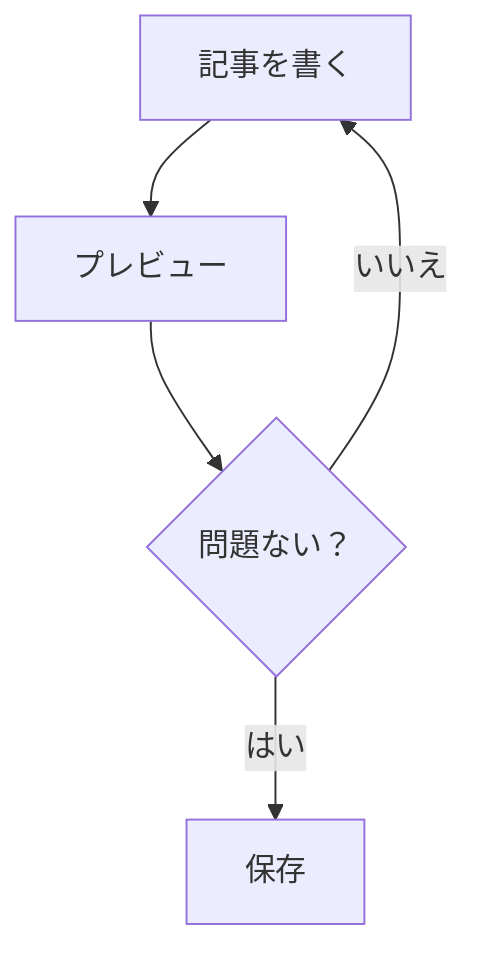
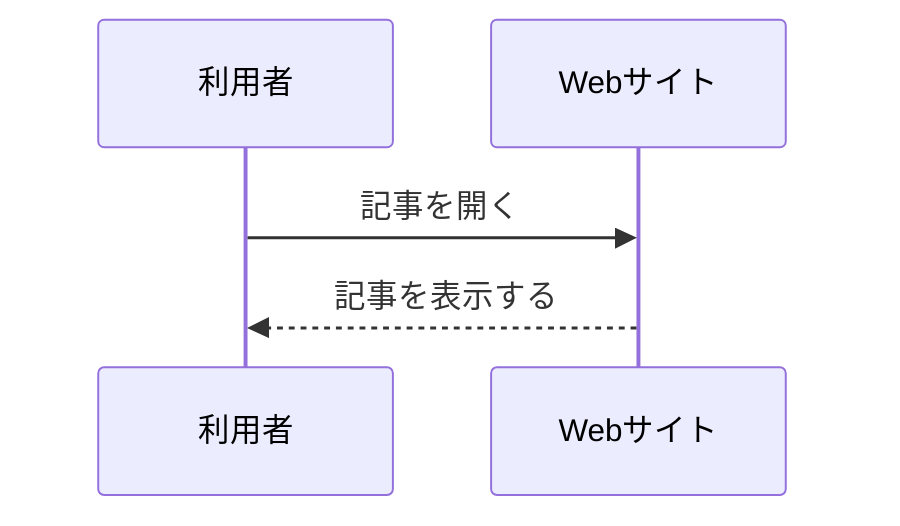

# 記事の書き方

このマニュアルでは、ITサークルのHPに掲載する記事の書き方を説明します。

Markdownの基本から、HTMLを使った画像・PDF・SNSの埋め込みまで、順番に解説します。プログラミングやWeb開発の経験がなくても、基本編を読めば記事を書けるようになることを目指しています。

## 目次

1. [基礎編：Markdownの基本](#1-基礎編markdownの基本)
2. [応用編：HTMLを使った表現](#2-応用編htmlを使った表現)
3. [その他の機能・特殊な記法](#3-その他の機能特殊な記法)
4. [記事作成の実践](#4-記事作成の実践)
5. [参考文献](#5-参考文献)

---

# 1. 基礎編：Markdownの基本

## 1-1. Markdownとは？

Markdown（マークダウン）は、文章に簡単な記号を付けることで、見出しや太字、リンクなどを表現できる記法です。

例えば、次のように記述します。

```markdown
# 見出し

これは普通の文章です。

**これは太字です。**

[ITサークルのHP](https://example.com)
```

このように、特別なソフトを使わなくても、テキストだけで文章の構造や装飾を指定できます。

Markdownで書いた文章は、HP側の変換処理によってHTMLに変換され、ブラウザ上に表示されます。

**まずは、以下の記法を覚えれば通常の記事を作成できます。**

## 1-2. 見出し

見出しは、行の先頭に `#` を付けて作成します。

```markdown
# 大見出し
## 中見出し
### 小見出し
#### より小さな見出し
```

`#` の数が多いほど、見出しの階層が下がります。最大6段階まで指定できます。

**使い方の例**

```markdown
# 夏休みの活動報告

## ゲーム開発

### 制作したもの

## Web開発

### HPの制作
```

見出しを使うと、文章の構造が分かりやすくなります。

- `#`：記事全体のタイトル
- `##`：記事の主要な項目
- `###`：主要な項目の中の小見出し

見出しの階層は、できるだけ順番に使いましょう。例えば、`##` の次にいきなり `####` を使うのは避けます。

## 1-3. 段落・改行

文章を段落ごとに分ける場合は、間に空行を入れます。

```markdown
これは1つ目の段落です。

これは2つ目の段落です。
```

Markdownでは、通常の改行と段落の区切りは異なります。

文章を読みやすくするため、話題が変わるところで空行を入れましょう。

## 1-4. 文字の装飾

記号で文章を囲むことで、文字を装飾できます。

| 表現 | 記述方法 | 表示例 |
|---|---|---|
| 太字 | `**太字**` | **太字** |
| 斜体 | `*斜体*` | *斜体* |
| 太字＋斜体 | `***強調***` | ***強調*** |
| 取り消し線 | `~~削除~~` | ~~削除~~ |
| マーカー | `==重要==` | ==重要== |

太字は重要な言葉や結論、取り消し線は訂正や削除した内容などに使います。

マーカーはこのHP独自の表示機能です。一般的なMarkdownでは共通して使える記法ではありません。

## 1-5. リスト（箇条書き）

項目を並べるときは、箇条書きを使うと読みやすくなります。

**箇条書き**

行の先頭に `-` または `*` を付けます。

```markdown
- ゲーム開発
- Web開発
- 3Dモデリング
```

**番号付きリスト**

番号と `.` を付けます。

```markdown
1. 企画
2. 設計
3. 開発
4. テスト
```

**入れ子にする**

項目の先頭にスペースを入れると、下の階層にできます。

```markdown
- Web開発
  - HTML
  - CSS
  - JavaScript
- ゲーム開発
  - Unity
  - Godot
```

関連する項目をまとめるときに便利です。

## 1-6. リンク

文章にリンクを設定するには、次の形式を使います。

```markdown
[表示する文字](リンク先のURL)
```

例えば、

```markdown
[Google](https://www.google.com/)
```

と書くと、Googleという文字にリンクが設定されます。

記事の中で外部サイトを紹介するときや、別の記事へ誘導するときに使います。

## 1-7. 画像

画像を挿入するには、先頭に `!` を付けます。

```markdown

```

例えば、

```markdown

```

と記述します。

`!` を付け忘れると、画像ではなくリンクとして表示されます。

画像の説明には、何が写っているのかを簡潔に記述しましょう。

画像のサイズ調整やリンク設定については、応用編の「画像の特殊埋め込み」で説明します。

## 1-8. 引用

他の文章や発言を引用するときは、行の先頭に `>` を付けます。

```markdown
> これが引用文です。
```

引用の中にさらに引用を作ることもできます。

```markdown
> これは引用です。
>
> > これは引用の中の引用です。
```

他人の文章や資料を引用する場合は、出典も明記しましょう。

## 1-9. コードの表示

プログラムやコマンドなどを表示するときに使います。

**インラインコード**

文章の一部分をコードとして表示します。

```markdown
HTMLでは `div` タグを使用します。
```

**コードブロック**

複数行のコードを表示します。文章の前後を3つのバッククォートで囲みます。

````markdown
```javascript
const message = "Hello World";
console.log(message);
```
````

最初のバッククォートの後ろに言語名を書くと、対応している場合は構文に色が付きます。

よく使う指定例：

| 言語 | 指定 |
|---|---|
| HTML | `html` |
| CSS | `css` |
| JavaScript | `javascript` |
| Python | `python` |
| C++ | `cpp` |
| JSON | `json` |
| テキスト | `text` |

コードを紹介するときは、できるだけ言語名も指定しましょう。

## 1-10. 表（テーブル）

表は `|` と `-` を使って作成します。

```markdown
| 名前 | 学年 | 担当 |
|---|---|---|
| Aさん | 2年 | Web開発 |
| Bさん | 1年 | ゲーム開発 |
```

最初の行が見出しになり、2行目が区切り線になります。

列の位置を指定することもできます。

```markdown
| 左寄せ | 中央寄せ | 右寄せ |
|:---|:---:|---:|
| A | B | C |
| D | E | F |
```

- `:---`：左寄せ
- `:---:`：中央寄せ
- `---:`：右寄せ

表は情報を整理するのに便利ですが、列数が多すぎるとスマートフォンで読みにくくなるため注意しましょう。

## 1-11. 水平線

話題を大きく区切る場合は、`---` を単独の行に記述します。

```markdown
ここまでが前半です。

---

ここからが後半です。
```

---

# 2. 応用編：HTMLを使った表現

Markdownは簡単に文章を装飾できますが、画像の細かなサイズ調整や複雑なレイアウトなどは苦手です。

そのような場合にはHTMLを使います。

## 2-1. HTMLの基本

### HTMLとは？

HTML（HyperText Markup Language）は、Webページの構造や内容を記述するための言語です。

Markdownと異なり、タグと呼ばれる記号を使って文章や画像などの要素を指定します。

### タグの基本構造

HTMLの基本形は次のとおりです。

```html
<タグ名>内容</タグ名>
```

例えば、段落を表す `p` タグは次のように書きます。

```html
<p>これは段落です。</p>
```

- `<p>`：開始タグ
- `これは段落です。`：内容
- `</p>`：終了タグ

開始タグと終了タグで内容を囲むのが基本です。

### 属性とは？

タグには、属性を付けて追加情報を指定できます。

```html
<a href="https://example.com">リンク</a>
```

この場合、`href` が属性名、`https://example.com` が属性値です。

### よく使うHTMLタグ

| タグ | 用途 |
|---|---|
| `<div>` | 複数の要素をまとめる |
| `<span>` | 文章の一部分を囲む |
| `<p>` | 段落を作る |
| `<br>` | 改行する |
| `<a>` | リンクを設定する |
| `` | 画像を表示する |
| `<strong>` | 重要な文章を強調する |
| `<details>` | 折りたたみ可能な領域を作る |
| `<summary>` | 折りたたみ領域の見出しを作る |

### HTMLを使う際の注意

HTMLはタグの組み合わせを間違えると、表示が崩れることがあります。

```html
<!-- 正しい例 -->
<div>
  <p>文章です。</p>
</div>
```

タグの対応関係を確認し、入れ子（タグの中に別のタグを入れること）を正しく記述しましょう。

また、このHPで利用できるHTMLや属性には制限がある場合があります。表示されない場合は、プレビューで確認してください。`script`タグや不明な外部コードなどは使用しないでください。

## 2-2. HTML構文の実例

ここからは、実際の記事で使用するHTMLの例を紹介します。

### ① 画像の特殊埋め込み

通常のMarkdown画像では、画像のサイズやリンク先を細かく指定しにくい場合があります。

HTMLを使うと、画像のサイズを指定したり、画像そのものにリンクを設定したりできます。

**画像のサイズを指定する**

```html

```

- `src`：画像ファイルの場所
- `alt`：画像の説明
- `width`：画像の幅

`width="600"` は幅を600ピクセルに指定する例です。高さは画像の縦横比を保つように表示されます。

このHPのCSSでは、画像が記事の表示幅を超えないように設定されています。そのため、大きな画像を指定しても画面からはみ出しにくくなっています。

**画像にリンクを設定する**

画像を `<a>` タグで囲みます。

```html
<a href="https://example.com">
  
</a>
```

画像をクリックすると、指定したリンク先に移動します。

画像をクリックして大きな画像を開かせたい場合や、作品の紹介ページに移動させたい場合などに使えます。

### ② PDFの埋め込み

PDFを記事内に表示するには、Google Driveのプレビュー機能を利用できます。

**手順1：PDFをGoogle Driveにアップロードする**

1. Google Driveを開く。
2. PDFファイルをアップロードする。
3. ファイルの共有設定を確認する。
4. ファイルのリンクを取得する。

公開記事から閲覧してもらう場合は、閲覧者に必要なアクセス権限が設定されているか確認してください。

**手順2：ファイルIDを確認する**

Google DriveのファイルURLは、一般的に次のような形式です。

```text
https://drive.google.com/file/d/ファイルID/view
```

`d/` と `/view` の間にある文字列がファイルIDです。

**手順3：HTMLで埋め込む**

```html
<iframe
  src="https://drive.google.com/file/d/ファイルID/preview"
  width="100%"
  height="600"
  title="資料のPDF"
></iframe>
```

`/view` ではなく `/preview` を指定することで、Google Driveのプレビュー画面を埋め込めます。

- `src`：表示するPDFのURL
- `width`：表示幅
- `height`：表示高さ
- `title`：内容を説明するタイトル

**リンクからPDFを開く方法**

埋め込みがうまく表示されない場合に備えて、通常のリンクも用意すると親切です。

```markdown
[PDFを開く](https://drive.google.com/file/d/ファイルID/view)
```

> [!WARNING]
> 個人情報や公開許可のない資料を、誰でも閲覧できる設定にしないでください。共有設定を確認してから公開しましょう。

### ③ SNSの埋め込み

SNSの投稿を記事内に表示するには、各SNSが提供する埋め込みコードを利用します。

基本的な流れは次のとおりです。

1. 埋め込みたい投稿を開く。
2. SNS側の共有メニューから埋め込み機能を探す。
3. 発行されたHTMLコードをコピーする。
4. 記事内の表示したい場所に貼り付ける。
5. プレビューで表示を確認する。

SNSによって埋め込み方法や必要なJavaScriptが異なります。**各サービスが提供する公式の埋め込みコードを使用してください。**

埋め込みが表示されない場合は、通常の投稿URLも併記すると、読者が投稿を確認できます。

### ④ 成果物カードの埋め込み

成果物カードは、制作した作品やプロジェクトを画像・タイトル・説明・リンクなどでまとめて紹介するための表示形式です。

例えば、次のような情報を掲載します。

- 作品の画像
- 作品名
- 簡単な説明
- 制作者や制作時期
- 作品の公開先・詳細ページへのリンク

HTMLの基本的な構造は次のようになります。

```html
<div class="work-card">
  <a href="https://example.com">

    

    <div class="work-card-content">
      <h3>作品名</h3>
      <p>作品の概要を簡潔に説明します。</p>
      <span>詳細を見る</span>
    </div>

  </a>
</div>
```

`work-card` や `work-card-content` は、HTML要素を識別するためのクラス名です。サイト側のCSSで同じクラス名に対するデザインが定義されている場合に、そのデザインが適用されます。

> [!IMPORTANT]
> 上記は一般的なHTML構造の例です。このHPで実際に使う成果物カードのクラス名や記述方法は、サイト側の実装に合わせてください。既存のテンプレートがある場合は、そちらをコピーして使用しましょう。

### ⑤ 文字の色・大きさを変える

HTMLの `style` 属性にCSSを記述すると、文字の色やサイズなどを変更できます。

**文字の色を変える**

```html
<span style="color: blue;">青い文字</span>
```

色はカラーコードでも指定できます。

```html
<span style="color: #2563eb;">青い文字</span>
<span style="color: #e11d48;">赤い文字</span>
```

**文字の大きさを変える**

```html
<span style="font-size: 20px;">大きな文字</span>
```

`font-size` で文字サイズを指定します。

- `16px`：16ピクセル
- `1.2em`：親要素の文字サイズの1.2倍
- `1.5rem`：ページの基準となる文字サイズの1.5倍

**複数の装飾を組み合わせる**

```html
<span style="
  color: #2563eb;
  font-size: 20px;
  font-weight: bold;
">
  色・サイズ・太さを変更した文字
</span>
```

CSSの指定は `;` で区切ります。

装飾を増やしすぎると文章が読みにくくなるため、重要な部分に絞って使いましょう。

---

# 3. その他の機能・特殊な記法

ここでは、通常の記事ではあまり使わないものの、図解や数式などを掲載するときに便利な機能を紹介します。

## 3-1. Mermaid（ダイアグラム）

Mermaidは、テキストで記述した内容をフローチャートやシーケンス図などに変換する機能です。

図形を一つずつ配置する必要がなく、コードを変更するだけで図を更新できます。

**基本的な使い方**

通常のコードブロックと同じように、バッククォート3つで囲み、先頭に `mermaid` と指定します。

````markdown

````

**よく使うダイアグラム**

| 種類 | 用途 |
|---|---|
| フローチャート | 処理や作業の流れ |
| シーケンス図 | 人やシステム間のやり取り |
| ガントチャート | スケジュール・進捗管理 |
| マインドマップ | アイデアや情報の整理 |
| ER図 | データベースの構造 |

**シーケンス図の例**

````markdown

````

Mermaidは記号の書き間違いなどで図が表示されないことがあります。最初は簡単な図から作り、プレビューで確認しながら編集しましょう。

## 3-2. LaTeX（数学表記）

LaTeXは、数式をきれいに表現するための記法です。

数学や物理の式を記事に掲載するときに使用します。このHPではKaTeXによる数式表示を利用する構成になっています。

### インライン数式

文章の中に数式を表示します。

```markdown
円の面積は $S = \pi r^2$ で求められます。
```

### ブロック数式

数式を独立した行に表示します。

```markdown
$$
S = \pi r^2
$$
```

### よく使う記法

| 表現 | 記法 |
|---|---|
| 分数 | `\frac{a}{b}` |
| 平方根 | `\sqrt{x}` |
| 指数 | `x^2` |
| 下付き文字 | `a_1` |
| 総和 | `\sum_{i=1}^{n} i` |
| 積分 | `\int_0^1 x\,dx` |
| ギリシャ文字 | `\alpha`、`\beta`、`\pi` |

**組み合わせた例**

```markdown
$$
\frac{1}{2}mv^2
$$
```

数式の記述には多くの命令がありますが、すべてを覚える必要はありません。必要なものをその都度調べて使いましょう。

なお、KaTeXはLaTeXのすべての機能に対応しているわけではありません。表示できない命令もあるため、プレビューで確認してください。

## 3-3. GitHub形式のアラート

アラートは、注意事項や重要な情報を目立たせるための機能です。

GitHubで使われている記法を利用します。

基本的な構造は次のとおりです。

```markdown
> [!NOTE]
> ここに説明を記述します。
```

アラートは5種類あります。

| 種類 | 用途 |
|---|---|
| NOTE | 補足情報 |
| TIP | 便利な方法・ヒント |
| IMPORTANT | 特に重要な情報 |
| WARNING | 注意が必要な情報 |
| CAUTION | 危険や不利益につながる可能性がある情報 |

**記述例**

```markdown
> [!NOTE]
> これは補足情報です。

> [!TIP]
> この方法を使うと作業を効率化できます。

> [!IMPORTANT]
> 公開前に必ずプレビューを確認してください。

> [!WARNING]
> ファイルの共有設定に注意してください。

> [!CAUTION]
> 公開してはいけない情報を掲載しないでください。
```

用途に合った種類を選び、重要な情報を伝えるときに使いましょう。多用すると、かえって重要な箇所が分かりにくくなるため注意してください。

## 3-4. その他のMarkdown記法

### チェックリスト

タスクの進捗などを表現できます。

```markdown
- [x] 企画を決定
- [x] 設計を完了
- [ ] 実装を完了
- [ ] テストを実施
```

`[x]` は完了、`[ ]` は未完了を表します。

### テーブルの配置指定

表の区切り行に `:` を付けることで、文字の配置を指定できます。

```markdown
| 左寄せ | 中央寄せ | 右寄せ |
|:---|:---:|---:|
| A | B | C |
```

### エスケープ

Markdownでは、特定の記号に意味が割り当てられています。

その記号を通常の文字として表示したい場合は、直前に `\` を付けます。

例えば、`#` を見出しとして扱わせずに表示する場合は、次のように記述します。

```markdown
\# これは見出しではありません
```

---

# 4. 記事作成の実践

ここまでの内容を使って、実際に記事を書いてみましょう。

## 4-1. 記事の基本構成

記事の内容によって構成は変わりますが、活動報告であれば次のような構成が考えられます。

```markdown
# 記事のタイトル

## 概要

いつ、何を行ったのかを簡潔に説明します。

## 活動内容

具体的に取り組んだ内容を紹介します。

## 成果・結果

完成したものや得られた成果を紹介します。

## 感想・振り返り

活動を通じて感じたことや学んだことをまとめます。

## 関連リンク

[関連するWebサイト](https://example.com)
```

最初に記事全体の構成を考えてから書き始めると、内容を整理しやすくなります。

## 4-2. 公開前のチェックリスト

記事を書き終えたら、以下を確認しましょう。

- [ ] 誤字脱字がない
- [ ] 見出しの階層が適切である
- [ ] 画像が正しく表示されている
- [ ] リンク先が正しい
- [ ] 表やコードブロックが崩れていない
- [ ] PDF・SNSなどの埋め込みが表示されている
- [ ] スマートフォンでも読みやすい
- [ ] 個人情報や公開許可のない情報が含まれていない
- [ ] プレビューで最終確認した

特に、HTMLや外部サービスの埋め込みは、編集画面だけでは正常に動作するか分からない場合があります。必ず公開ページに近い状態で確認しましょう。

## 4-3. 困ったときは

| 症状 | 確認すること |
|---|---|
| 記号がそのまま表示される | Markdownの記述や対応状況 |
| 画像が表示されない | URL・ファイル名・保存場所 |
| PDFが表示されない | ファイルID・共有権限・埋め込みURL |
| HTMLが表示されない | タグの書き方・サイト側の許可設定 |
| Mermaidが表示されない | コードの構文・コードブロックの指定 |
| 数式が表示されない | `$` の数・LaTeXの命令 |

解決しない場合は、無理に別のコードで回避しようとせず、担当者に相談してください。

---

# 5. 参考文献

本マニュアルの作成にあたり、以下の公式ドキュメント・技術資料を参考にしています。

### Markdown

- [GitHub Docs：Basic writing and formatting syntax](https://docs.github.com/en/get-started/writing-on-github/getting-started-with-writing-and-formatting-on-github/basic-writing-and-formatting-syntax)
- [GitHub Flavored Markdown Specification](https://github.github.com/gfm/)
- [CommonMark Specification](https://spec.commonmark.org/)

### HTML・CSS

- [MDN：HTMLの基本構文](https://developer.mozilla.org/ja/docs/Learn_web_development/Core/Structuring_content/Basic_HTML_syntax)
- [MDN：HTML要素リファレンス](https://developer.mozilla.org/ja/docs/Web/HTML/Reference/Elements)
- [MDN：CSSによるスタイル設定の基本](https://developer.mozilla.org/ja/docs/Learn_web_development/Core/Styling_basics)

### Google Drive

- [Google Drive ヘルプ：ファイルを表示する、開く](https://support.google.com/drive/answer/2423485?hl=ja)
- [Google for Developers：DocumentObject.embedUrl](https://developers.google.com/workspace/drive/picker/reference/picker.documentobject.embedurl?hl=ja)

### Mermaid

- [Mermaid公式ドキュメント](https://mermaid.js.org/)
- [Mermaid：フローチャート](https://mermaid.js.org/syntax/flowchart.html)
- [Mermaid：シーケンス図](https://mermaid.js.org/syntax/sequenceDiagram.html)

### LaTeX・数式表示

- [KaTeX：Supported Functions](https://katex.org/docs/supported)

