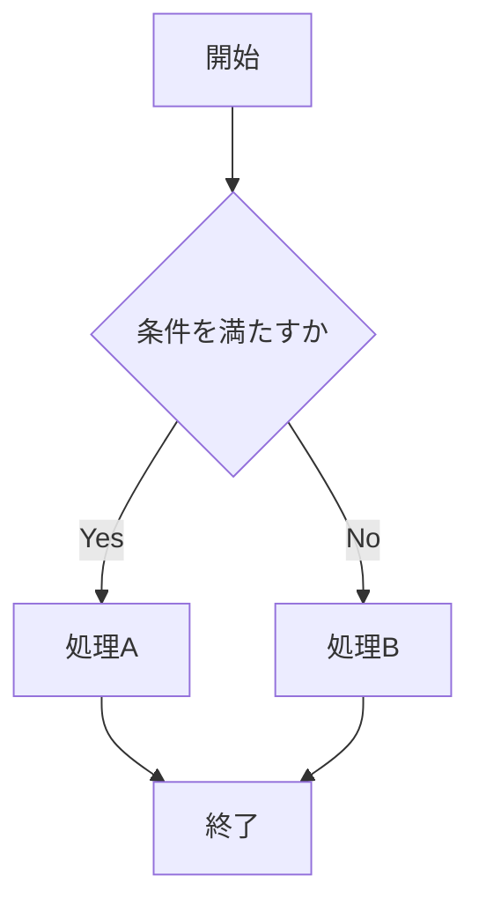
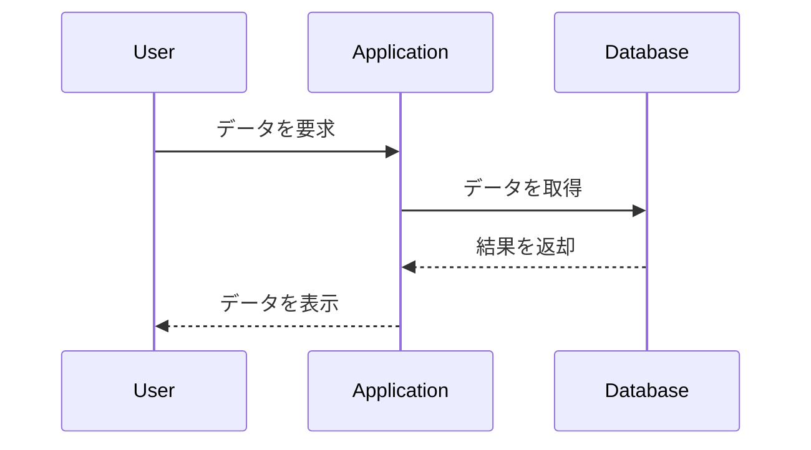

# Markdown Preview テスト

これは **VS Code + Markdown Preview Enhanced** 用の総合スタイルテストです。

本文のフォント、文字サイズ、行間、リンク、強調、見出し、引用、リスト、表、画像、コードブロック、タスクリスト、アラート、Mermaid、数式、目次（TOC）などの表示を確認します。

---

以下は目次生成機能の確認用です。

<!-- toc -->

目次が自動生成される場合、見出しの階層構造やリンク先が正しく反映されているか確認してください。

---

## 1. 見出しテスト

### H3 見出し

#### H4 見出し

##### H5 見出し

###### H6 見出し

見出しのサイズ、太さ、色、本文との間隔などを確認してください。

---

## 2. 本文・文字装飾

これは通常の本文です。日本語と英語が混在する文章や、長い文章を記述した場合の表示も確認します。

**太字のテキスト**

*斜体のテキスト*

***太字かつ斜体のテキスト***

~~取り消し線~~

==マーカー風のテキスト==

`inline code`

文章の途中に `A1:B100` や `SUM(A1:A10)` のようなインラインコードを入れた場合の表示も確認します。

リンクの表示も確認します。

[Markdown Preview Enhanced](https://github.com/shd101wyy/markdown-preview-enhanced)

---

## 3. 画像

画像の表示サイズや本文との配置を確認します。


---

## 4. リスト

### 箇条書き

- 1つ目の項目です。
- 2つ目の項目です。
  - ネストした項目です。
    - さらに内側にネストした項目です。
- 3つ目の項目です。

### 番号付きリスト

1. 最初の項目です。
2. 次の項目です。
   1. ネストした項目です。
      1. さらに内側にネストした項目です。
3. 最後の項目です。

---

## 5. 引用

> これは通常の引用です。
>
> Markdown文書では、重要な補足説明や参考情報を引用として表示することがあります。
>
> > これはネストした引用です。
> >
> > さらに内側の引用です。

---

## 6. 水平線

本文の区切りを確認します。

---

## 7. テーブル

| 項目 | 内容 | 状態 | 数値 |
| --- | --- | --- | ---: |
| Markdown | 本文 | 完了 | 100 |
| CSS | スタイル | 作業中 | 75 |
| Mermaid | 図 | 未確認 | 50 |
| KaTeX | 数式 | 未確認 | 25 |
| PDF | 印刷 | 未確認 | 0 |

### Markdownの配置指定

| 左寄せ | 中央 | 右寄せ |
| :--- | :---: | ---: |
| 左 | 中央 | 100 |
| テキスト | テキスト | 200 |
| ABC | XYZ | 300 |

---

## 8. 長いテーブル

| ID | 名前 | 説明 | 長い説明 |
| --- | --- | --- | --- |
| 001 | 項目A | テスト | これは非常に長い説明文です。本文幅が狭い場合に、テーブルがどのように表示されるかを確認するための文章です。 |
| 002 | 項目B | テスト | これは非常に長い説明文です。列幅やセル内の折り返しが適切に処理されるか確認します。 |
| 003 | 項目C | テスト | さらに長い文章を入れて、横方向の表示やセル内の折り返しを確認します。 |

---

## 9. タスクリスト

- [ ] 未完了のタスク
- [x] 完了したタスク
- [ ] CSSを確認する
- [x] Markdownファイルを作成する

---

## 10. NOTE / TIP / IMPORTANT / WARNING / CAUTION

以下はアラート記法のテストです。

> [!NOTE]
> これは NOTE のテストです。
>
> 補足情報や参考情報を表示します。

> [!TIP]
> これは TIP のテストです。
>
> 作業を効率化するためのヒントを表示します。

> [!IMPORTANT]
> これは IMPORTANT のテストです。
>
> 特に重要な情報を表示します。

> [!WARNING]
> これは WARNING のテストです。
>
> 注意が必要な情報を表示します。

> [!CAUTION]
> これは CAUTION のテストです。
>
> 危険性や注意事項を表示します。

---

## 11. コードブロック

### JavaScript

```javascript
function testMarkdownPreview() {
    const message = "Hello Markdown!";
    console.log(message);

    if (message) {
        return true;
    }

    return false;
}
```

### Python

```python
def fibonacci(n):
    """フィボナッチ数列の先頭 n 項を生成する。"""
    a, b = 0, 1
    result = []

    for _ in range(n):
        result.append(a)
        a, b = b, a + b

    return result


print(fibonacci(10))
```

### C++

```cpp
#include <iostream>
#include <vector>

int main() {
    std::vector<int> numbers = {1, 2, 3, 4, 5};

    for (const auto& number : numbers) {
        std::cout << number << '\n';
    }

    return 0;
}
```

---

## 12. LaTeX・数式プレビュー

KaTeXによる数式のレンダリングを確認します。

### 12.1 インライン数式

文章中に数式を埋め込むテストです。

円の面積は $S = \pi r^2$ で表されます。

二次方程式 $ax^2 + bx + c = 0$ の解は、解の公式を用いて求められます。

また、オイラーの等式 $e^{i\pi} + 1 = 0$ も表示してみます。

### 12.2 基本的な数式

足し算・引き算・掛け算・割り算：

$$
a + b,\quad a - b,\quad a \times b,\quad a \div b
$$

分数：

$$
\frac{a+b}{c+d}
$$

平方根：

$$
\sqrt{x},\quad \sqrt[n]{x}
$$

指数・対数：

$$
a^n,\quad \log_a x,\quad \ln x
$$

### 12.3 総和・総乗

総和：

$$
\sum_{k=1}^{n} k = \frac{n(n+1)}{2}
$$

総乗：

$$
\prod_{k=1}^{n} k = n!
$$

### 12.4 行列

$$
A =
\begin{pmatrix}
1 & 2 & 3 \\
4 & 5 & 6 \\
7 & 8 & 9
\end{pmatrix}
$$

行列式：

$$
\det(A) =
\begin{vmatrix}
a & b \\
c & d
\end{vmatrix}
= ad - bc
$$

### 12.5 連立方程式

$$
\begin{cases}
2x + y = 5 \\
x - y = 1
\end{cases}
$$

### 12.6 微分・積分

微分：

$$
\frac{d}{dx}x^n = nx^{n-1}
$$

積分：

$$
\int x^n\,dx = \frac{x^{n+1}}{n+1} + C
\quad (n \neq -1)
$$

定積分：

$$
\int_0^1 x^2\,dx = \frac{1}{3}
$$

### 12.7 極限

$$
\lim_{n \to \infty}
\left(1+\frac{1}{n}\right)^n = e
$$

### 12.8 場合分け

$$
f(x) =
\begin{cases}
x^2 & (x \geq 0) \\
-x & (x < 0)
\end{cases}
$$

### 12.9 数式の位置合わせ

$$
\begin{aligned}
(a+b)^2
&= (a+b)(a+b) \\
&= a^2+2ab+b^2
\end{aligned}
$$

### 12.10 ギリシャ文字・数学記号

$$
\alpha,\ \beta,\ \gamma,\ \Delta,\ \theta,\ \lambda,\ \mu,\ \pi,\ \sigma,\ \omega
$$

$$
\in,\ \notin,\ \subset,\ \subseteq,\ \cup,\ \cap,\ \forall,\ \exists
$$

---

## 13. Mermaid

フローチャートやシーケンス図などの描画を確認します。

### フローチャート



### シーケンス図

